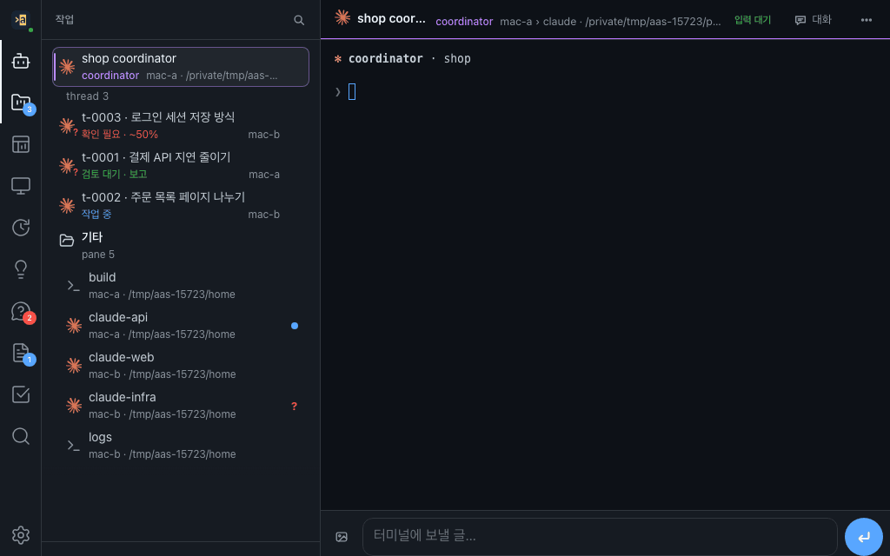
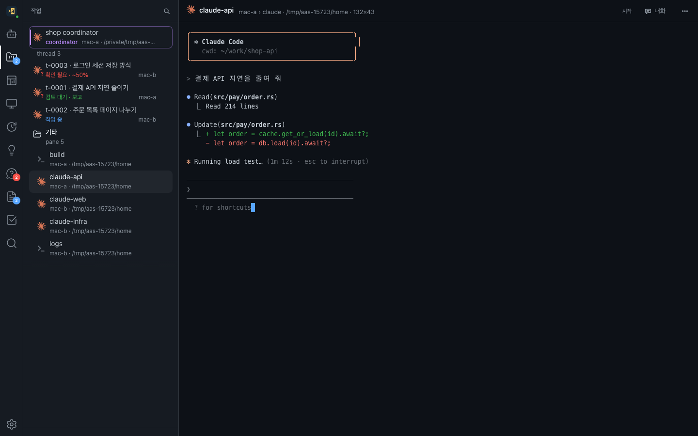
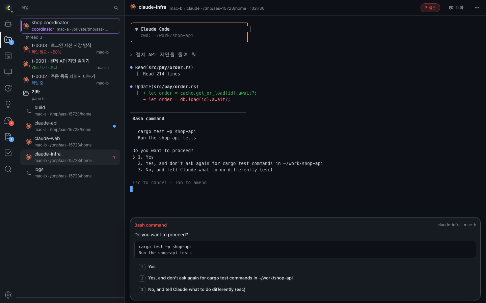
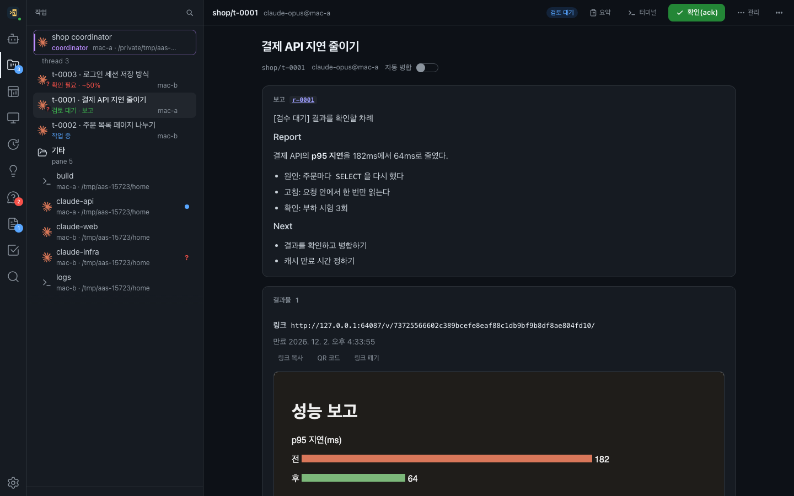
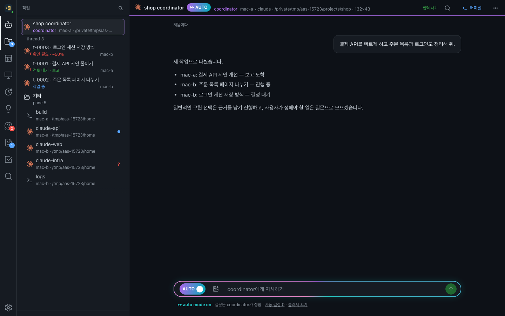
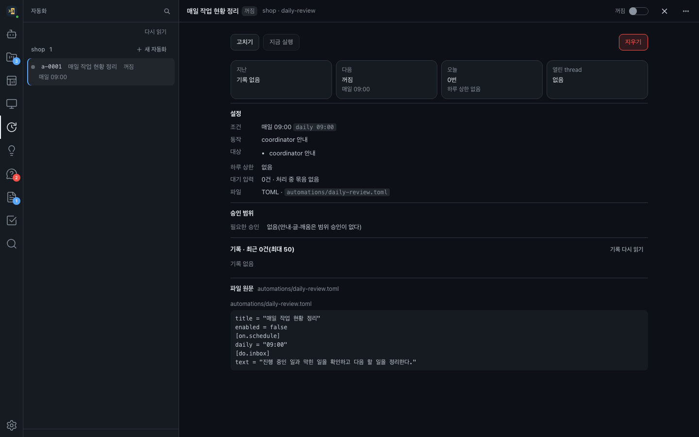
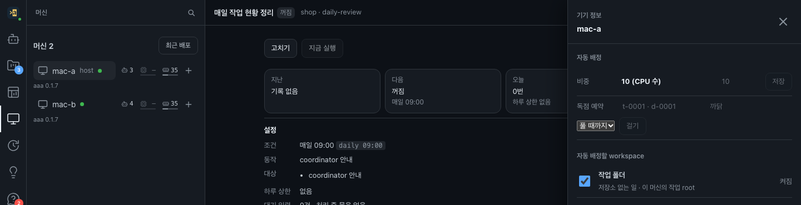
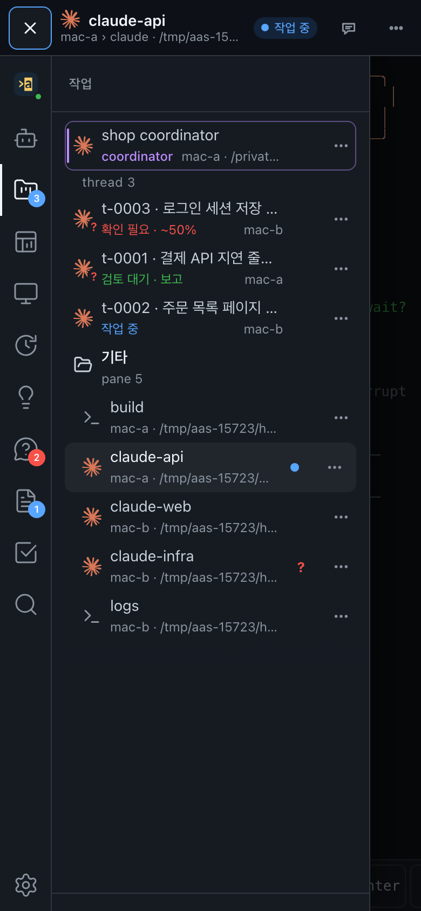

# aaa

**Any Agent, Anywhere. 여러 머신의 코딩 agent에게 일을 맡기고, 웹과 휴대폰에서 이어 갑니다.**

Claude Code·Codex가 각 머신에서 일하고, aaa는 그 터미널과 작업을 host 한 곳에 모읍니다. coordinator에게 목표를 말하면 thread가 머신마다 일을 나눠 하고, 사용자는 브라우저에서 진행을 보고 질문에 답하고 결과를 엽니다. host 한 대에 macOS·Linux·Windows 머신을 연결할 수 있습니다.

[빠른 시작](#빠른-시작) · [문서](docs/README.md) · [사용법](docs/usage.md) · [개발](CONTRIBUTING.md)



## 무엇을 하나

- **한 목록, 웹 터미널.** 머신마다 열린 agent·셸과 작업 상태를 한 목록에서 보고, 같은 터미널에 바로 입력합니다.
- **coordinator와 thread.** coordinator가 일을 나눠 thread에 맡기고, thread는 자기 worktree·branch 또는 작업 폴더에서 일한 뒤 보고합니다.
- **질문 카드.** agent 확인창과 작업 중 결정할 일을 카드로 모아 답합니다.
- **보고서와 결과물.** 진행·완료 보고와 그림·영상·웹 결과물을 읽고, 지난 보고를 검색합니다.
- **할 일과 아이디어.** 할 일 목록에서 thread를 시작하고, 아이디어 노트를 전용 thread와 함께 다듬습니다.
- **auto mode와 자동화.** coordinator가 일반 질문을 판단하게 하거나, 일정·작업 사건을 조건으로 일을 시작합니다.
- **휴대폰.** 같은 작업과 터미널을 홈 화면 앱으로 쓰고 알림을 받습니다.



| 질문에 답하기 | 결과 보고 읽기 |
| --- | --- |
|  |  |

| auto mode 켜고 끄기 | 자동화 조건과 실행 기록 |
| --- | --- |
|  |  |

| 머신별 자동 배정 | 휴대폰의 작업 목록 |
| --- | --- |
|  |  |

화면은 가짜 머신 `mac-a`·`mac-b`와 견본 프로젝트를 띄운 실험실에서 GitHub Dark 테마로 찍었습니다. 실제 계정·운영 화면은 담지 않습니다.

## 빠른 시작

### 1. host 준비

host는 웹과 프로젝트를 맡는 Mac 한 대입니다. [host 설치](docs/host-setup.md)대로 실행 파일·launcher·설정·서비스를 준비합니다.

### 2. 머신 연결

연결할 각 머신의 일반 터미널에서 실행합니다. 스크립트가 맞는 release를 받아 SHA-256을 확인하고 `aaa setup`을 엽니다.

```sh
curl -fsSL https://cLazyZombie.github.io/aaa/install.sh | sh     # macOS · Linux
```

```powershell
irm https://cLazyZombie.github.io/aaa/install.ps1 | iex          # Windows, 관리자 PowerShell
```

setup이 host 주소·머신 이름·작업 폴더를 묻고 확인 코드를 보여 줍니다. host 웹의 **설정 → 머신 → 등록 창 열기**에서 그 코드로 승인하면 서비스가 뜨고 host에 연결됩니다. OS별 준비·수동 다운로드·갱신·제거는 [머신 설치](docs/install.md)에 있습니다.

### 3. 웹과 휴대폰

host에서 웹을 tailnet에 공개하고 짝짓기 코드를 받습니다.

```sh
aaa web publish
aaa web pair
```

표시된 HTTPS 주소를 브라우저에서 열고 코드를 넣습니다. 휴대폰도 같은 tailnet에 로그인합니다. iPhone은 Safari의 **공유 → 홈 화면에 추가**로 연 앱에서 알림을 켭니다.

### 4. 첫 프로젝트

host에서 프로젝트를 만들고 coordinator를 엽니다. 저장소는 미리 준비합니다. 다른 머신의 저장소는 `경로@머신`으로 줍니다.

```sh
aaa project create shop --repo ~/work/shop
aaa coordinator open
```

웹에서 coordinator에게 할 일을 말합니다. thread의 진행은 목록에서, 결정은 **답할 것**에서, 결과는 보고에서 봅니다. auto mode와 자동화는 [사용법](docs/usage.md)과 [자동화](docs/automations.md)에 있습니다.

## 문서

| 문서 | 내용 |
| --- | --- |
| [사용법](docs/usage.md) | 웹 화면·단축키·자주 쓰는 CLI |
| [host 설치](docs/host-setup.md) · [머신 설치](docs/install.md) | 설치·갱신·제거 |
| [자동화](docs/automations.md) | 일정·사건 조건과 실행 기록 |
| [보고서 운영](docs/library.md) | 결과물·보관·공유 링크 |
| [머신별 workspace](docs/workspace-access.md) | 머신마다 자동 배정할 저장소 |

전체 목록은 [docs/README.md](docs/README.md)에 있습니다.

## 개발

소스 빌드·검사·README 그림 재생성은 [CONTRIBUTING](CONTRIBUTING.md)에 있습니다.

## 라이선스

aaa 코드는 [MIT](LICENSE)입니다. 웹에 함께 넣은 npm 패키지와 [Meslotendard](https://github.com/cLazyZombie/Meslotendard) 글꼴(OFL 1.1)의 고지는 host 웹의 `/licenses/THIRD_PARTY_NOTICES.txt`와 [web/public/fonts/meslotendard-0.3.1/](web/public/fonts/meslotendard-0.3.1/)에 있습니다([자세히](CONTRIBUTING.md#라이선스-고지)).
