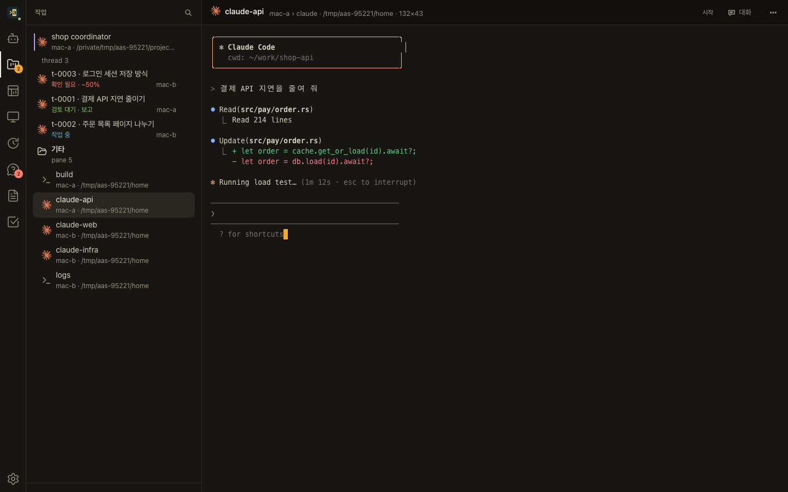
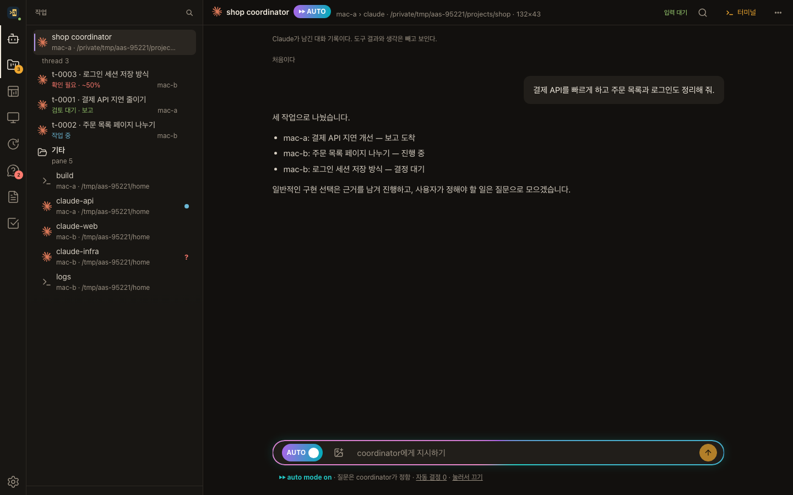
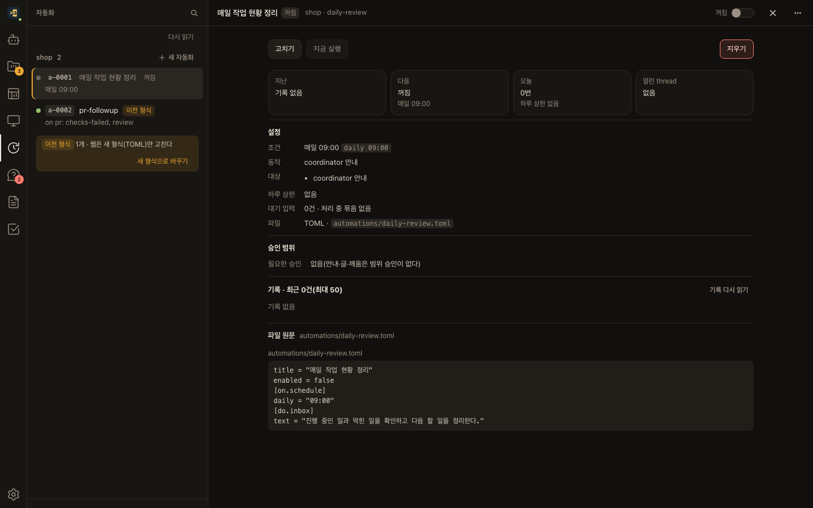
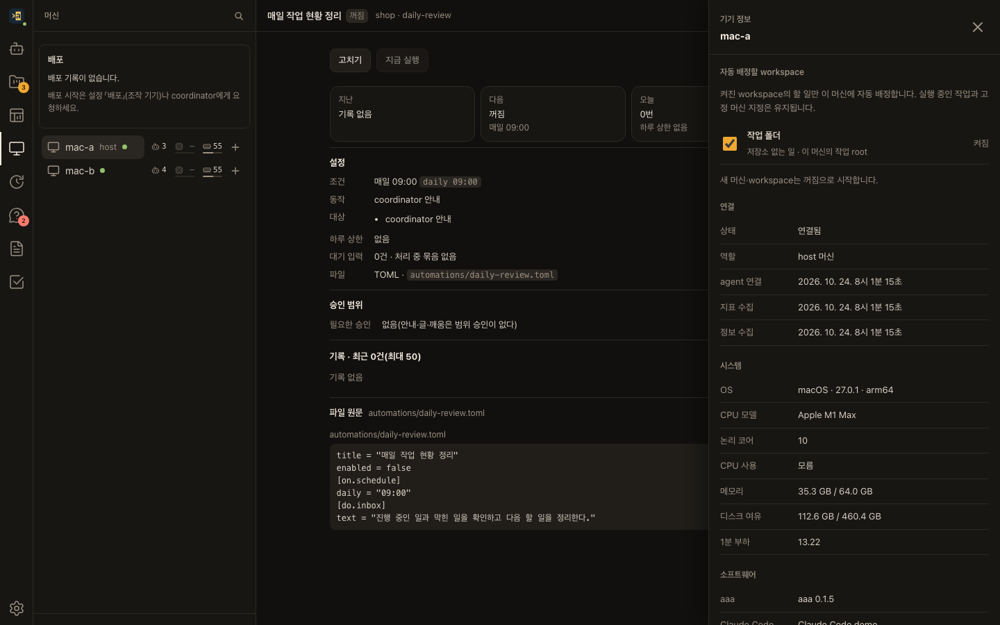

# aaa

**Any Agent, Anywhere. 여러 머신의 코딩 agent에게 일을 맡기고, 웹과 휴대폰에서 이어 갑니다.**

Claude Code·Codex가 각 머신에서 일하고, aaa는 그 터미널과 작업을 한곳에 모읍니다. CLI로 세션을 만들고 제어하며, 브라우저에서는 진행을 보고 질문에 답하고 결과물을 엽니다. host 한 대에 macOS·Linux·Windows agent를 연결할 수 있습니다.

[설치](#설치) · [첫 프로젝트](#첫-프로젝트) · [사용법](docs/usage.md) · [개발](#개발)


## 한곳에서 맡기고 확인하기

- **한 목록, 웹 터미널.** 머신마다 열린 agent·셸과 작업 상태를 보고, 같은 터미널에 바로 입력합니다. 탭과 분할 창도 쓸 수 있습니다.
- **coordinator와 thread.** 프로젝트의 coordinator에게 목표를 말합니다. 작업은 별도 thread의 worktree·branch 또는 일반 폴더에서 진행하고, 지침과 기억을 공유합니다.
- **질문 카드.** agent 확인창과 작업 중 결정할 일을 모아 보고 답합니다. 답한 질문도 다시 열어 당시 선택을 확인할 수 있습니다.
- **보고서와 결과물.** 진행·완료 보고, 그림·영상·웹 결과물을 읽고 필요한 보고서는 보관합니다.
- **휴대폰.** 같은 작업과 터미널을 좁은 화면에서 다룹니다. 홈 화면 앱과 알림도 지원합니다.
- **auto mode.** 켜 둔 프로젝트에서는 coordinator가 일반 질문을 판단하고 까닭을 기록합니다. 사용자 전용 결정·비밀값·위험한 변경 같은 예외는 계속 묻습니다. 언제든 끄거나 결정 재검토를 요청할 수 있습니다.
- **자동화.** 일정·작업 사건 등의 조건으로 coordinator에게 알리거나 thread를 시작합니다. 실행 대상과 승인 범위, 최근 기록을 웹에서 확인합니다.
- **머신별 workspace.** 어느 머신에 어떤 저장소·작업 폴더의 일을 자동 배정할지 정합니다. 새 머신과 workspace는 자동 배정이 꺼진 채 시작합니다.



| 질문에 답하기 | 결과 보고 읽기 |
| --- | --- |
|  |  |

| auto mode 켜고 끄기 | 자동화 조건과 실행 기록 |
| --- | --- |
|  |  |

| 머신별 자동 배정 | 휴대폰의 작업 목록 |
| --- | --- |
|  |  |

화면은 **가짜 머신 `mac-a`·`mac-b`, 가짜 agent와 견본 프로젝트**로 새로 촬영했습니다. 실제 계정·운영 화면을 담지 않습니다. GIF는 실제 UI의 네 장면을 이어 붙인 짧은 시연입니다.

## 설치

**host를 먼저 준비하고 각 머신에서 `aaa setup`으로 agent를 연결합니다.** ✋는 사용자가 자기 터미널이나 설정 화면에서 직접 해야 하는 단계입니다.

> 이 README는 현재 main의 기능을 설명합니다. 공개 release **v0.1.5에는 `aaa setup`이 없습니다.** 아래 setup 흐름에는 현재 소스 빌드 또는 이 기능을 포함한 새 배포 실행 파일이 필요합니다. 기존 Windows 한 줄 설치는 `aaa install`을 실행하는 별도 경로이며, macOS·Linux 다운로드용 한 줄 설치는 아직 제공하지 않습니다.

아래에서 설치 뒤의 `aaa`는 설치된 실행 파일을 뜻합니다. macOS·Linux의 기본 경로는 `~/.local/bin/aaa`, Windows는 `%USERPROFILE%\.local\bin\aaa.exe`입니다. PATH에 없다면 전체 경로로 실행하세요.

### 준비물과 역할

| 역할 | 환경 | 준비할 것 |
| --- | --- | --- |
| host | macOS 운영 절차 제공 | aaa, Tailscale 로그인, 고정 launcher와 사용자 권한 설정 |
| macOS agent | GUI 로그인한 사용자 | aaa와 launcher, 사용할 agent CLI의 설치·로그인 |
| Linux agent | glibc·systemd | aaa, 실행 중인 사용자 systemd manager, agent CLI의 설치·로그인 |
| Windows agent | Windows x86_64 | aaa, 관리자 권한의 대화형 콘솔, agent CLI의 설치·로그인, Windows 로그인 암호 |

host는 웹과 프로젝트 상태를 관리하고, 각 agent는 자기 머신의 터미널과 작업 폴더를 관리합니다. 웹은 host에만 연결합니다. 웹을 닫거나 연결이 끊겨도 머신에서 실행 중인 세션은 이어집니다. 머신 재부팅이 실행 중인 프로세스까지 보존하는 것은 아닙니다.

실행 파일은 [GitHub releases](https://github.com/cLazyZombie/aaa/releases)에서 자기 OS·CPU에 맞는 것을 받고 같은 release의 `SHA256SUMS`로 확인합니다. 내려받은 판에 필요한 기능이 있는지 `aaa --version`과 `aaa setup --help`로 확인하세요. 현재 main을 직접 빌드하려면 [개발](#개발)을 따릅니다.

### 1. host 준비 ✋

host 설치는 `setup`의 대상이 아닙니다. [운영 설치 점검표](docs/install-runbook.md)의 launcher 준비 → host 설정 → host 서비스 등록 순서를 따릅니다. macOS의 개발자 도구·전체 디스크 접근 권한과 키체인은 사용자가 직접 설정합니다. 기존 설치가 있으면 새 설정으로 덮어쓰지 않습니다.

host가 실행되면 웹을 열고 사용할 기기를 연결합니다.

```sh
~/.local/bin/aaa web publish
~/.local/bin/aaa web pair
```

✋ 표시된 tailnet HTTPS 주소를 브라우저에서 열고 1회용 코드를 넣습니다. 읽기 전용 기기는 `web pair --reader`로 연결합니다. 휴대폰도 같은 tailnet에 로그인해야 합니다. iPhone은 Safari의 **공유 → 홈 화면에 추가**로 열고 그 앱에서 알림을 켭니다.

웹 **설정 → 머신 → 등록 창 열기**를 누르거나 host 터미널에서 등록 창을 엽니다.

```sh
~/.local/bin/aaa machine enroll --open 10m
```

### 2. 각 머신에서 agent 설치 ✋

aaa의 pane 밖, **설치할 사용자 계정의 일반 터미널**에서 실행합니다. `host.example.ts.net`은 예시이므로 host의 주소로 바꿉니다. SSH로 실행할 때는 `ssh -t`로 대화형 터미널을 붙입니다.

**macOS**

```sh
./aaa setup --host host.example.ts.net --name mac-a
```

사용자 LaunchAgent로 등록하며 로그인 뒤 자동 실행합니다. 기존 `~/Applications/aaa-launcher.app`을 보존해 사용합니다. 새 Mac은 실행 파일과 맞는 launcher package가 필요합니다. ✋ 개발자 도구·전체 디스크 접근 권한, 잠긴 키체인은 사용자가 직접 처리합니다. [macOS 준비와 설치](docs/unix-setup.md#macos)를 따릅니다.

**Linux**

```sh
./aaa setup --host host.example.ts.net --name linux-a
```

기본은 systemd 사용자 서비스입니다. 로그아웃 뒤에도 유지되는지는 사용자 manager·linger 설정에 달려 있으며 설치기가 linger를 켜지 않습니다. 부팅 때 실행할 시스템 서비스를 원하면 일반 사용자로 다음 명령을 실행합니다.

```sh
./aaa setup --service systemd-system --host host.example.ts.net --name linux-a
```

✋ unit 등록·시작에 필요한 권한만 `sudo`로 받습니다. 설치기 전체를 `sudo`로 실행하지 않습니다. [Linux 서비스와 로그](docs/unix-setup.md#linux)를 참고하세요.

**Windows**

```powershell
.\aaa.exe setup --host host.example.ts.net --name win-a
```

같은 실행 파일을 `aaa-setup.exe`로 받은 경우 `.\aaa-setup.exe`만 실행해도 됩니다. ✋ 관리자 권한의 대화형 콘솔에서 계획을 확인하고 **Windows 로그인 암호를 설치기의 숨김 입력칸에만** 입력합니다. PIN과는 다릅니다. 암호를 채팅·질문 답·명령 인자·보고서에 넣지 않습니다. 사용자 계정으로 Windows 서비스를 등록해 그 계정의 agent 로그인과 환경을 사용합니다. [Windows 설치기](docs/windows-setup.md)에 상세 절차가 있습니다.

세 OS 모두 host 주소·머신 이름·작업 폴더와 변경 계획을 확인한 뒤 등록을 진행합니다. ✋ 설치기에 나온 확인 코드를 host 웹의 **승인을 기다리는 머신 → 승인**에 입력합니다. 설치기는 같은 실행에서 파일·설정·서비스를 준비하고 host 연결까지 확인합니다.

### 3. 완료 확인과 첫 연결

설치한 머신에서:

```sh
aaa setup --status
```

host에서:

```sh
~/.local/bin/aaa machine list
```

**서비스 실행과 host 연결이 모두 확인되고, host 목록에서 새 머신이 「연결」이면 agent 설치가 끝난 것입니다.** 연결 실패 뒤 서비스를 남겼다는 것만으로 설치 완료로 보지 않습니다. 설치기가 표시한 로그 위치와 오류를 확인합니다.

Codex를 쓰는 머신은 hook을 설치합니다. ✋ 새 Codex 세션의 Hooks 화면에서 aaa hook을 검토하고 신뢰합니다.

```sh
aaa integration install codex
aaa doctor
```

웹의 머신 정보에서 **자동 배정할 workspace**를 고릅니다. 저장소와 작업 폴더가 준비된 머신만 켜세요. 자동 배정과 명시적 머신 지정의 차이는 [workspace 설정](docs/workspace-access.md)에 있습니다.

### 갱신·제거

setup으로 설치한 agent는 **새 실행 파일로 같은 instance의 setup을 다시 실행**합니다. 등록을 유지하고 서비스를 갱신·재시작해 연결을 확인합니다. host·이름을 바꾸거나 예전 설치 방식에서 옮길 때는 각 OS 문서의 제거·충돌 안내를 따릅니다.

```sh
aaa setup --status
aaa setup --uninstall
```

제거해도 실행 파일은 남습니다. 설정·상태까지 지우는 `--purge`와 별도 instance의 조회·제거는 [Unix](docs/unix-setup.md#상태갱신제거)·[Windows](docs/windows-setup.md#다시-실행상태제거) 문서를 먼저 확인하세요. host의 업데이트·되돌리기는 [운영 점검표](docs/install-runbook.md#9-업그레이드)를 따릅니다.

## 첫 프로젝트

host에서 프로젝트를 만들고 coordinator를 엽니다. 아래 예시의 저장소는 미리 준비합니다.

```sh
~/.local/bin/aaa project create shop --repo ~/work/shop
~/.local/bin/aaa project open shop
```

웹에서 coordinator에게 할 일을 말하세요. thread가 일하는 동안 목록에서 상태를 보고, **답할 것**에서 결정하고, 보고에서 결과와 다음 행동을 확인합니다. 원격 저장소는 `PATH@머신`으로 등록합니다.

auto mode는 coordinator의 **더 보기 메뉴**에서 켭니다. 자동 결정의 까닭과 남은 예외를 확인할 수 있고 언제든 끌 수 있습니다. 반복할 일은 **자동화**에서 조건·동작을 설정하고 필요한 실행 범위를 승인합니다. [사용법](docs/usage.md)과 [자동화](docs/automations.md)에 자세한 흐름이 있습니다.

## 문서

| 문서 | 내용 |
| --- | --- |
| [사용법](docs/usage.md) | 웹 화면·단축키·자주 쓰는 CLI |
| [macOS·Linux setup](docs/unix-setup.md) / [Windows setup](docs/windows-setup.md) | 준비·서비스·로그·갱신·제거 |
| [운영 설치 점검표](docs/install-runbook.md) | host 준비·기존 수동 설치·업데이트·복구 |
| [머신별 workspace](docs/workspace-access.md) | 자동 배정 허용과 고정 머신 지정 |
| [자동화](docs/automations.md) | 일정·사건·승인·실행 기록 |
| [보고서 운영](docs/library.md) | 결과물·보관·웹 보고서 sandbox |
| [구조 지도](docs/architecture.md) / [프로젝트 계획](docs/plan.md) | crate 역할과 설계 결정 |
| [시험 쓰는 법](docs/testing.md) | 유닛·통합·웹 E2E 검증 |

## 개발

Rust toolchain·Node.js·npm이 필요합니다. 웹을 먼저 빌드하면 Rust 실행 파일에 포함됩니다.

```sh
git clone https://github.com/cLazyZombie/aaa
cd aaa
(cd web && npm ci --no-audit --no-fund && npm run build)
cargo build --locked -p aaa --bin aaa
./target/debug/aaa --help
```

배포용은 `cargo build --locked --release -p aaa --bin aaa`로 빌드합니다. macOS launcher 준비는 [P0 절차서](docs/p0-runbook.md)를 따릅니다. Linux·Windows 실행 파일은 해당 환경에서 빌드합니다.

CI와 같은 단계는 `scripts/ci-local.sh`에 있습니다.

```sh
bash scripts/ci-local.sh                     # web fmt build clippy test e2e public
bash scripts/ci-local.sh --only web,e2e,public
```

웹 E2E는 Unix에서 Playwright 1.64.1의 Chromium·WebKit을 사용합니다. `npm install -g playwright@1.64.1`과 `npx playwright@1.64.1 install chromium webkit`으로 준비합니다. 별도 설치는 `NODE_PATH`를 지정합니다. 실패한 단계의 원인은 `target/ci-local/` 로그로 확인하며 재시도로 덮지 않습니다.

README 매체는 ffmpeg와 Chromium으로 재생성합니다. 앞의 웹·Rust 빌드가 먼저 필요합니다.

```sh
NODE_PATH=$(npm root -g) node web/e2e/showcase.mjs --readme docs/media
```

장면 목록과 격리·구성 참고는 [README 매체 안내](docs/readme-media.md)에 있습니다. 실험실은 가짜 홈·설정·머신 이름을 쓰며 운영 서비스에 붙지 않습니다. 촬영 뒤 띄운 프로세스를 정리합니다. 공개 전에 `bash scripts/check-public.sh`를 돌리고 그림 속 글자도 확인합니다. README 매체는 파일마다 1 MiB 아래로 유지합니다.

## 라이선스

aaa 코드는 [MIT](LICENSE)입니다.

웹 화면에 함께 넣은 npm 패키지(긴 소스 보기의 `@pierre/diffs`·`@pierre/theme`(Apache-2.0)과 Shiki(MIT)·`diff`(BSD-3-Clause), React·xterm 등)의 라이선스 고지는 웹 빌드가 모아 `web/dist/licenses/THIRD_PARTY_NOTICES.txt`에 둡니다(`web/scripts/license-notices.ts`). host는 그것을 웹 주소 `/licenses/THIRD_PARTY_NOTICES.txt`로 보냅니다.

웹 터미널에는 [Meslotendard](https://github.com/cLazyZombie/Meslotendard) 0.3.1 글꼴(Regular·Bold, WOFF2)을 함께 넣었습니다. 이 글꼴은 SIL Open Font License 1.1이고, 구성 원본 Meslo LG(Apache 2.0)·Nerd Fonts·Pretendard(OFL 1.1)의 고지는 [web/public/fonts/meslotendard-0.3.1/](web/public/fonts/meslotendard-0.3.1/)에 있습니다. host는 같은 고지를 웹 주소 `/fonts/meslotendard-0.3.1/`로도 보냅니다.
