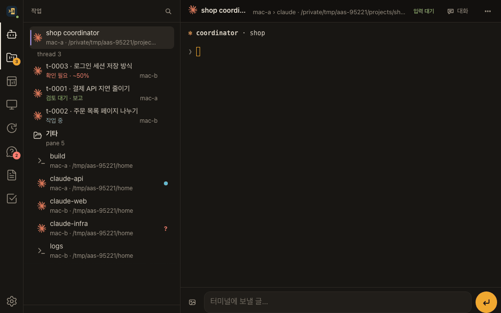
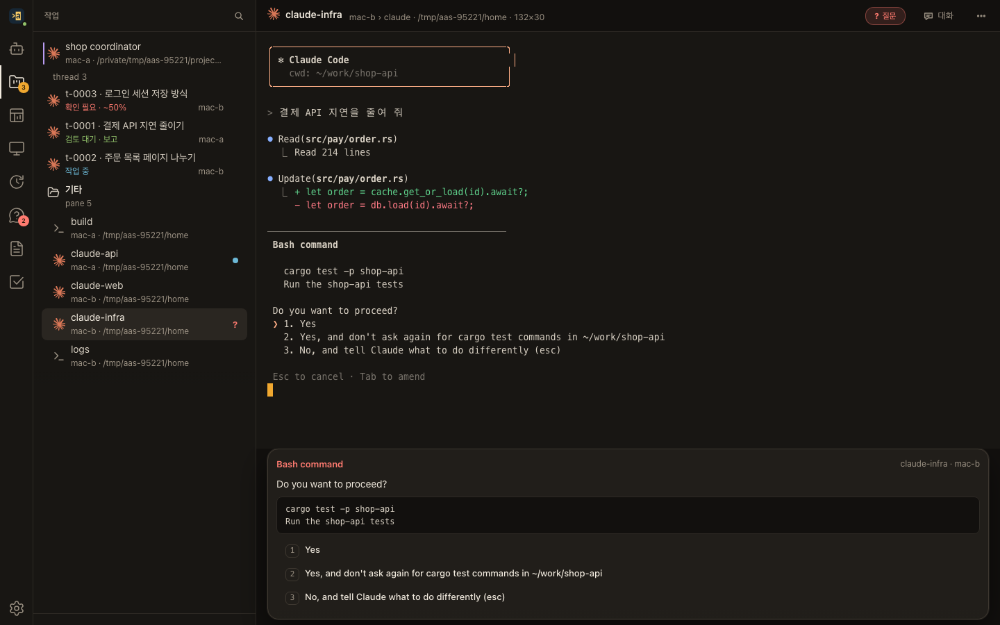
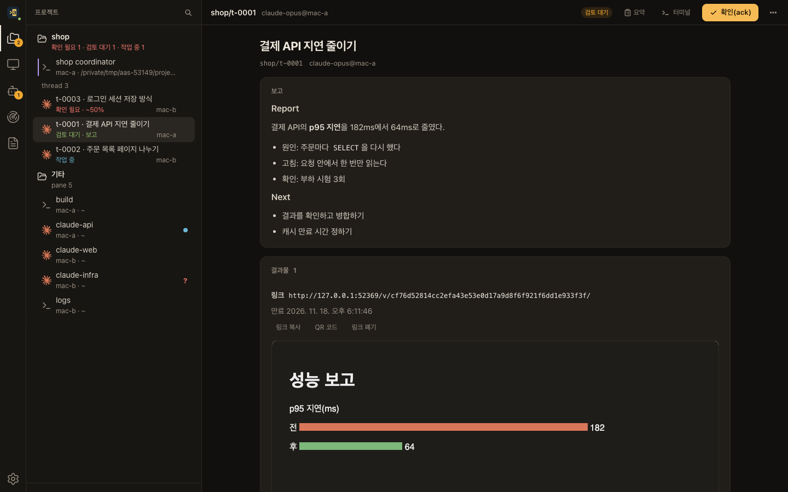
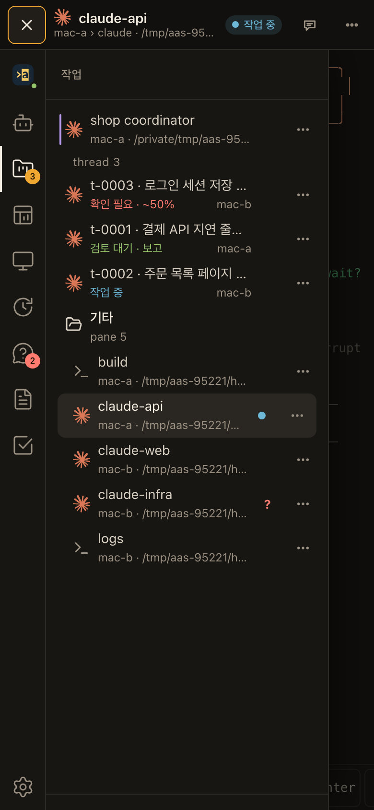

# aaa

**aaa = Any Agent, Anywhere.** 여러 Mac에서 도는 Claude Code·Codex를 한 화면에서 보고 움직입니다.

- **한 목록**: 모든 머신의 agent·터미널·thread가 상태(작업 중·질문·검토 대기·확인 필요)와 함께 한 목록에 모입니다.
- **웹 터미널**: 브라우저나 휴대폰에서 바로 치고, agent의 확인창에는 카드로 답합니다.
- **일 맡기기**: 프로젝트의 coordinator에게 말하면 일을 thread로 나눠 여러 머신에 맡기고, 끝나면 보고서가 옵니다.
- **끊겨도 이어짐**: 세션은 각 머신이 지킵니다. 웹을 닫거나 서비스를 다시 띄워도 agent는 계속 돕니다.



| 질문에 웹에서 답하기 | thread 보고서 |
|---|---|
|  |  |

<p align="center"></p>

> 화면은 가짜 머신(`mac-a`·`mac-b`)과 가짜 agent로 찍었습니다. 다시 찍기: `node web/e2e/showcase.mjs --readme docs/media`(아래 「개발」).

## Mac에 설치

Mac 한 대(**host Mac**)에 host와 agent를 두고, 다른 Mac은 agent만 더합니다. ✋ 표시는 사람이 직접 하는 단계입니다(GUI 설정이나 터미널에서 `yes` 입력). 순서와 확인 기준은 [운영 설치 점검표](docs/install-runbook.md)에 자세히 있습니다.

**준비물**: [Tailscale](https://tailscale.com/download/mac)(로그인), Xcode Command Line Tools(`xcode-select --install`), 쓸 agent CLI(`claude`·`codex`, 로그인까지).

### 1. aaa 받기

공개 [release](https://github.com/cLazyZombie/aaa/releases)에서 받아 체크섬을 확인하고 `~/.local/bin/aaa`에 둡니다. Intel Mac은 `aaa-macos-aarch64`를 `aaa-macos-x86_64`로 바꿉니다.

```bash
cd ~/Downloads
curl -fLO https://github.com/cLazyZombie/aaa/releases/latest/download/aaa-macos-aarch64
curl -fLO https://github.com/cLazyZombie/aaa/releases/latest/download/SHA256SUMS
grep ' aaa-macos-aarch64$' SHA256SUMS | shasum -a 256 -c     # 「OK」가 나와야 한다
mkdir -p ~/.local/bin && install -m 755 aaa-macos-aarch64 ~/.local/bin/aaa
~/.local/bin/aaa --version
```

명령은 늘 전체 경로 `~/.local/bin/aaa`로 칩니다(launchd·셸의 PATH에 기대지 않습니다).

### 2. launcher 등록(한 번) ✋

서비스는 작은 고정 launcher(`~/Applications/aaa-launcher.app`)가 띄웁니다. aaa를 바꿔도 이 등록은 다시 하지 않습니다.

```bash
git clone --depth 1 https://github.com/cLazyZombie/aaa ~/src/aaa
bash ~/src/aaa/p0/launcher/install.sh
```

✋ **시스템 설정 → 개인정보 보호 및 보안**에서 `~/Applications/aaa-launcher.app`(홈 폴더 → 응용 프로그램)을 **개발자 도구**와 **전체 디스크 접근 권한** 두 목록에 「+」로 넣고 켭니다. 자세한 것은 [P0 절차서](docs/p0-runbook.md)에 있습니다.

### 3. 설정

```bash
mkdir -p ~/.config/aaa
~/.local/bin/aaa config example host | sed 's/^mode = "child"/mode = "launchd"/' > ~/.config/aaa/host.toml   # host Mac만
~/.local/bin/aaa config example agent > ~/.config/aaa/agent.toml
~/.local/bin/aaa config check
```

host의 `[local_agent] mode`를 `launchd`로 바꿔 agent는 따로 서비스로 띄웁니다. 나머지는 예시 그대로 써도 됩니다(값 설명은 예시 파일의 주석).

### 4. 서비스 설치 ✋

launchd에 등록하므로 자기 터미널에서 치고 `yes`를 입력합니다. host를 agent보다 먼저 설치합니다. macOS가 「백그라운드 항목이 추가됨」을 띄우면 허용합니다.

```bash
~/.local/bin/aaa service install --role host  --aaa ~/.local/bin/aaa   # host Mac만
~/.local/bin/aaa service install --role agent --aaa ~/.local/bin/aaa
~/.local/bin/aaa status                                                # 로컬 머신이 연결돼 있으면 된다
```

Codex를 쓰면 hook도 설치합니다. 새 Codex 세션의 Hooks 화면에서 aaa hook을 신뢰합니다(✋).

```bash
~/.local/bin/aaa integration install codex
~/.local/bin/aaa doctor
```

### 5. 웹과 휴대폰

```bash
~/.local/bin/aaa web publish     # tailnet 안 HTTPS로 공개하고 주소를 보인다(기존 tailscale serve 항목은 건드리지 않는다)
~/.local/bin/aaa web pair        # 1회용 코드. 보기만 할 기기는 --reader
```

✋ 브라우저나 휴대폰에서 그 주소를 열고 코드를 넣습니다. iPhone은 Safari 공유 → 「홈 화면에 추가」로 앱처럼 쓰고, 알림은 그 앱에서 켭니다.

### 6. 다른 Mac 더하기

다른 Mac에서 1·2단계를 하고, `agent.toml`만 만들어 host 주소를 적습니다(`mac-a`는 host Mac의 tailnet 이름).

```bash
mkdir -p ~/.config/aaa
~/.local/bin/aaa config example agent | sed 's/^host = "local"/host = "mac-a.example.ts.net:7430"/' > ~/.config/aaa/agent.toml
```

그리고 agent 서비스를 설치하고(✋) host에 등록합니다.

```bash
~/.local/bin/aaa service install --role agent --aaa ~/.local/bin/aaa   # ✋ 새 Mac
~/.local/bin/aaa machine enroll --open 10m                     # host Mac: 등록 창을 연다
~/.local/bin/aaa agent enroll mac-a.example.ts.net:7430        # 새 Mac: 확인 코드가 나온다
~/.local/bin/aaa machine approve mac-b --code <코드>           # host Mac: 새 Mac 이름과 그 코드로 승인
~/.local/bin/aaa machine list                                  # host Mac: 모두 「연결」
```

### 업데이트

✋ 각 Mac의 일반 터미널에서 새 release로 바꾸고(`yes`) 서비스를 다시 띄웁니다. host Mac부터, host → agent 순서입니다. 세션은 그대로 이어집니다.

```bash
~/.local/bin/aaa update                          # 최신 release를 받아 검사 뒤 교체(--dry-run이면 검사만)
~/.local/bin/aaa service restart --role host     # host Mac만
~/.local/bin/aaa service restart --role agent
```

되돌리기는 `aaa update rollback`입니다. 판 고정·여러 머신 순서는 [점검표 9](docs/install-runbook.md#9-업그레이드)에 있습니다.

## 시작하기

```bash
~/.local/bin/aaa project create shop --repo ~/work/shop   # 프로젝트(저장소는 PATH 또는 PATH@머신)
~/.local/bin/aaa project open shop                        # coordinator를 띄운다
```

웹 목록에서 coordinator를 열고 할 일을 말하면 됩니다. 웹 화면·단축키·CLI는 [사용법](docs/usage.md)에 있습니다.

## 더 읽기

- [사용법](docs/usage.md): 웹 화면, 자주 쓰는 CLI
- [운영 설치 점검표](docs/install-runbook.md): 설치·업그레이드·되돌리기·coordinator 배포
- [보고서 운영](docs/library.md): 보고서 올리기·실시간 폴더·정리
- [프로젝트 계획](docs/plan.md): 구조(host·agent·front)와 설계 결정
- [시험 쓰는 법](docs/testing.md)

## 개발

CI(`.github/workflows/ci.yml`)와 같은 단계를 로컬에서 한 번에 돈다. 단계의 명령은 `scripts/ci-local.sh`에만 있고 CI도 이 스크립트를 단계별로 부른다.

```sh
bash scripts/ci-local.sh                     # 전부: web fmt build clippy test e2e public
bash scripts/ci-local.sh --only test,e2e     # 고른 단계만
bash scripts/ci-local.sh --skip e2e          # 빼고 전부
```

- 끝에 단계마다 걸린 시간과 결과를 요약하고, 실패한 단계는 로그 위치(`target/ci-local/<시각>/<단계>.log`)를 보인다. 실패를 다시 돌려 통과시키지 않는다.
- `e2e`는 웹 E2E(Playwright Chromium·WebKit)다. Unix만이고 playwright를 전역 npm 모듈로 찾는다: `npm install -g playwright@1.59.1 && npx playwright@1.59.1 install chromium webkit`.
- `public`은 공개 저장소 검사(`scripts/check-public.sh`)다. push 전에 돈다. 저장소 파일은 기본 1MiB 이하이며, 스크립트의 `size_limit`에 정확한 경로·이유·상한을 명시한 예외만 허용한다. 누적 설계 원문 `docs/plan.md`는 2MiB, 버전 고정 Meslotendard 0.3.1 Bold·Regular 글꼴은 각각 기존 2,163,908·2,137,228바이트까지다. 크기 예외도 금지 확장자·비밀값 검사는 그대로 받는다.
- README 그림은 가짜 실험실로 다시 찍는다(ffmpeg 필요). 영상 폴더를 더 주면 mp4도 만든다.
  ```sh
  (cd web && npm run build) && cargo build -p aaa
  NODE_PATH=$(npm root -g) node web/e2e/showcase.mjs --readme docs/media
  ```

## 라이선스

aaa 코드는 [MIT](LICENSE)입니다.

웹 화면에 함께 넣은 npm 패키지(긴 소스 보기의 `@pierre/diffs`·`@pierre/theme`(Apache-2.0)과 Shiki(MIT)·`diff`(BSD-3-Clause), React·xterm 등)의 라이선스 고지는 웹 빌드가 모아 `web/dist/licenses/THIRD_PARTY_NOTICES.txt`에 둡니다(`web/scripts/license-notices.ts`). host는 그것을 웹 주소 `/licenses/THIRD_PARTY_NOTICES.txt`로 보냅니다.

웹 터미널에는 [Meslotendard](https://github.com/cLazyZombie/Meslotendard) 0.3.1 글꼴(Regular·Bold, WOFF2)을 함께 넣었습니다. 이 글꼴은 SIL Open Font License 1.1이고, 구성 원본 Meslo LG(Apache 2.0)·Nerd Fonts·Pretendard(OFL 1.1)의 고지는 [web/public/fonts/meslotendard-0.3.1/](web/public/fonts/meslotendard-0.3.1/)에 있습니다. host는 같은 고지를 웹 주소 `/fonts/meslotendard-0.3.1/`로도 보냅니다.

Windows 최초 실행 파일은 [저장한 PowerShell bootstrap과 설치 시험 절차](docs/windows-bootstrap.md)를 따릅니다. 공식 새 release의 판/SHA를 확인하고 실행합니다.
