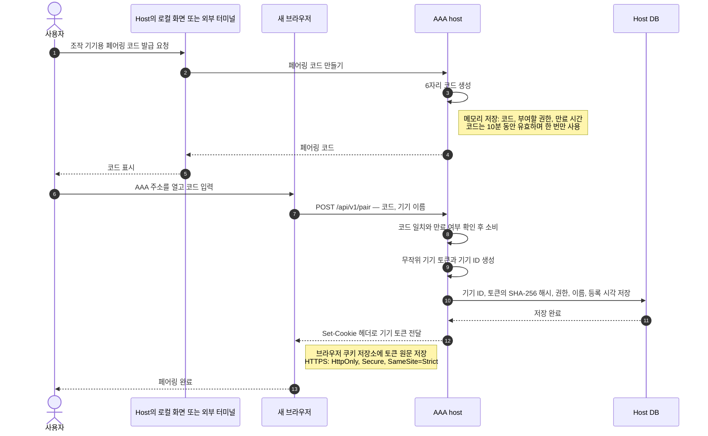
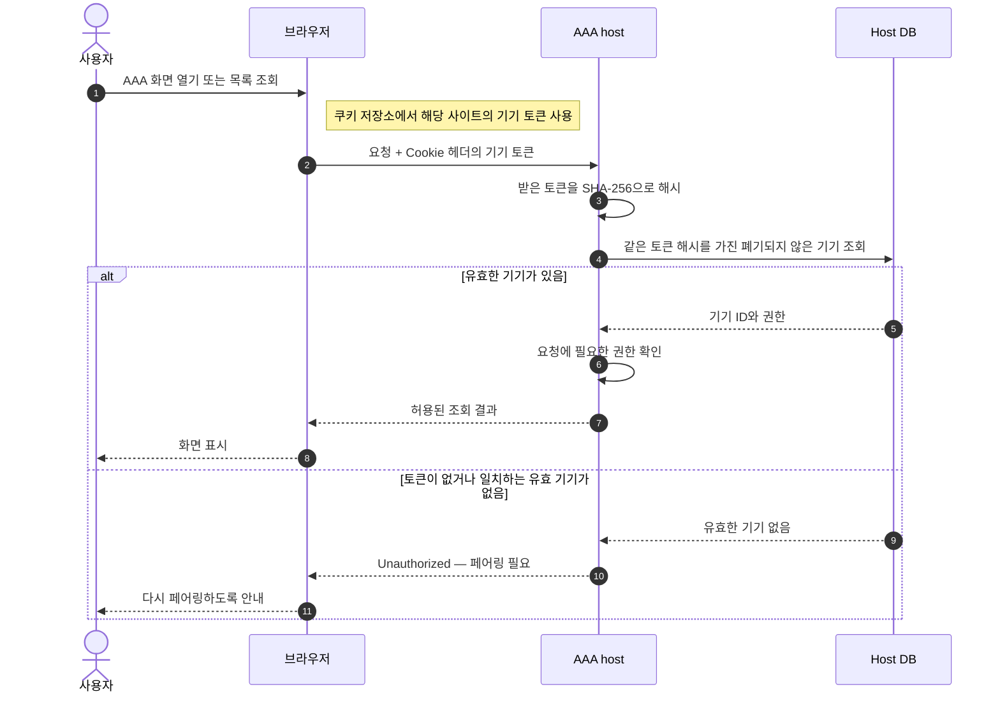
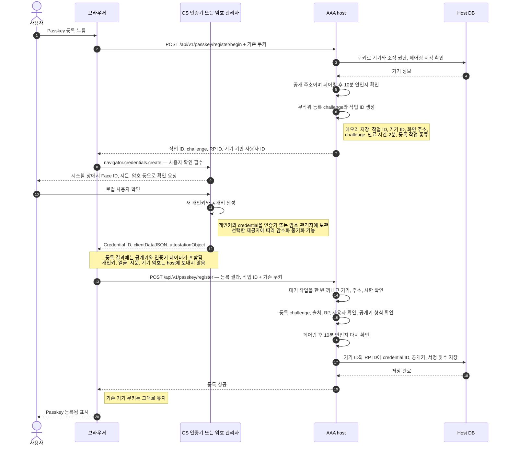
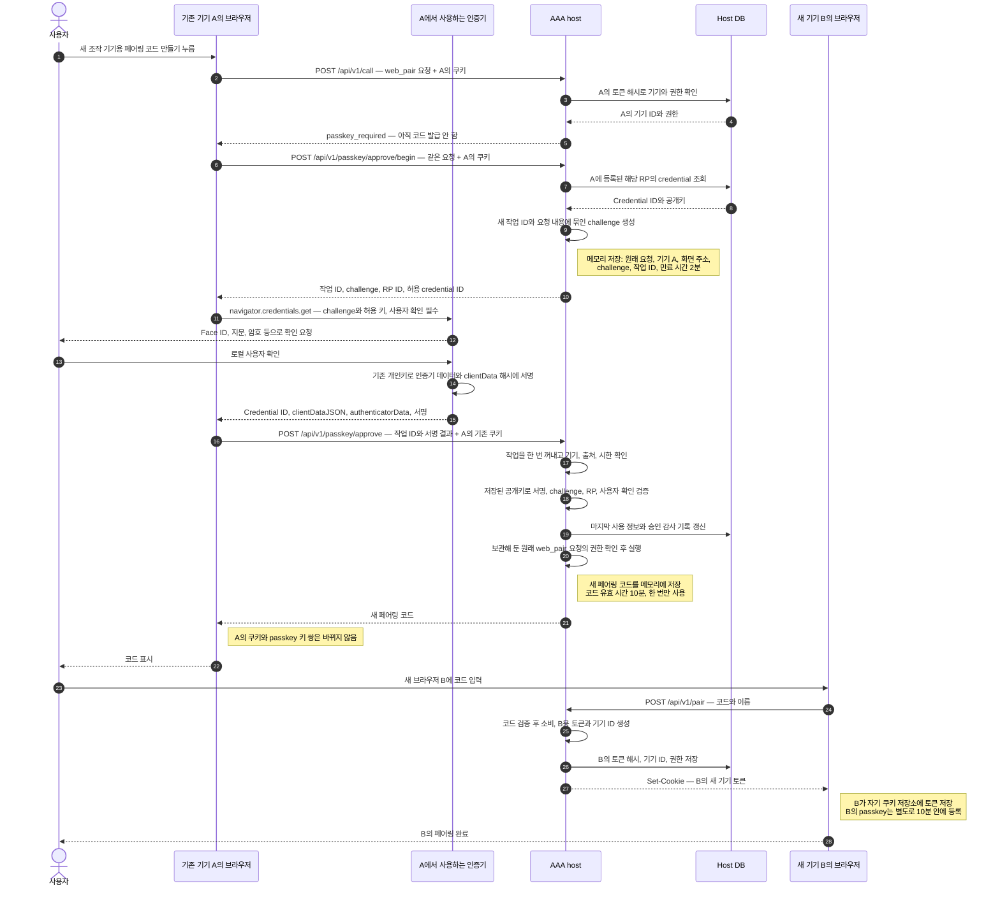

# AAA 인증: 페어링, 쿠키, passkey

AAA는 **페어링으로 브라우저의 접속을 허용하고, 쿠키로 그 접속 권한을 확인하며, 주요 관리 동작마다 passkey로 추가 승인을 받는다.** Passkey 승인은 쿠키를 갱신하지 않는다.

이 문서는 현재 저장소의 구현을 설명한다. 아래 네 시퀀스는 공개 HTTPS 주소로 접속한 조작 기기를 기준으로 한다. 각 다이어그램은 위에서 아래로 시간 순서대로 읽는다. 화살표는 요청·응답이나 내부 호출이고, `저장` 표시는 데이터가 남는 위치를 뜻한다. Host와 host DB는 같은 서버 안의 구성 요소다.

## 1. 먼저 알아둘 개념

| 개념 | 쉬운 설명 | AAA에서의 역할 |
|---|---|---|
| 페어링 코드 | 새 출입증을 발급받기 위한 일회용 초대 코드 | 처음 브라우저를 등록할 때 입력한다. |
| 기기 토큰 | 서버가 발급한 긴 비밀 문자열, 즉 출입증 | 이 토큰을 가진 요청을 등록된 기기의 요청으로 취급한다. |
| 쿠키 | 브라우저가 값을 보관하고 해당 사이트 요청에 자동으로 붙이는 방식 | AAA에서는 기기 토큰을 보관하고 전송한다. |
| 기기 ID | Host가 등록된 기기를 구별하는 번호 | 쿠키로 확인한 기기와 그 기기의 권한·passkey를 연결한다. |
| Passkey | 개인키와 공개키를 사용하는 인증 자격 | 등록한 키로 서명하고, host가 그 서명을 확인한다. |
| 개인키 | 서명을 만들 수 있는 비밀키 | 인증기·암호 관리자가 관리한다. AAA host에는 보내지 않는다. |
| 공개키 | 개인키로 만든 서명이 맞는지 확인하는 키 | Host DB에 저장한다. 공개키만으로 서명을 만들 수는 없다. |
| Credential ID | 사용할 passkey를 구별하는 식별자 | Host가 등록된 공개키를 찾고, 인증기가 해당 키를 선택하는 데 쓴다. 비밀 토큰과는 다르다. |
| Challenge | 이번 확인에만 쓰는 일회용 확인값 | 예전 서명을 가져와 이번 요청에 사용하는 것을 막는다. |
| 전자서명 | 특정 데이터에 개인키로 만든 검증 가능한 결과 | 데이터가 바뀌거나 다른 개인키를 쓰면 등록된 공개키로 검증되지 않는다. |
| UV: 사용자 확인 | 인증기가 기기 안에서 사용자를 확인한 결과 | Face ID·Touch ID·기기 암호·인증기 PIN 등이 해당한다. AAA는 특정 방법을 강제하지 않고 UV를 요구한다. |
| RP ID | Passkey가 속하는 서비스의 도메인 이름 | AAA에서는 공개 주소의 도메인이다. |
| Origin | 웹 화면의 출처: 프로토콜·도메인·포트 | 서명 응답이 예상한 AAA 화면에서 만들어졌는지 확인한다. |
| Operation ID | 승인 대기 중인 작업의 번호 | Challenge, 원래 요청, 기기, 화면 주소, 만료 시간을 연결한다. |

AAA에서 말하는 **기기는 페어링으로 만들어진 브라우저 등록 항목**이다. 같은 물리적 휴대폰이라도 브라우저나 별도 저장 공간을 쓰는 홈 화면 앱은 서로 다른 등록 항목이 될 수 있다.

## 2. 시퀀스 A: 최초 페어링 — 브라우저에 출입증 발급

처음에는 브라우저에 기기 토큰이 없다. 사용자는 host Mac의 직접 접속 화면이나 AAA 밖 터미널에서 페어링 코드를 얻는다. 이미 passkey를 등록한 조작 기기에서 코드를 발급할 수도 있으며, 그 경우는 시퀀스 D와 같다.



### 무엇이 어디에 남는가

| 위치 | 저장하는 것 | 목적 |
|---|---|---|
| Host 메모리 | 아직 쓰지 않은 코드·권한·만료 시간 | 코드를 확인하고 한 번만 사용하게 한다. 성공하면 소비된다. |
| 브라우저 쿠키 저장소 | 기기 토큰 원문 | 이후 요청에 출입증으로 붙인다. |
| Host DB | 토큰의 해시와 기기 ID·권한 등 | 받은 토큰을 해시해 등록된 기기를 찾는다. 토큰 원문을 DB에 보관하지 않는다. |

`Set-Cookie`는 **서버가 브라우저에 보내는 저장 지시**다. 서버가 브라우저 디스크에 직접 쓰는 것이 아니라, 응답을 받은 브라우저가 쿠키 저장소에 기록한다.

HTTPS 기본 인스턴스에서는 `__Host-aaa`라는 쿠키 이름을 쓴다. 이름 있는 인스턴스는 구별되는 접미사를 붙인다. 쿠키의 `Max-Age`는 1년으로 설정되지만, 기기를 폐기하면 그 전에라도 서버가 토큰을 거부한다.

## 3. 시퀀스 B: 이후 접속 — 쿠키로 기기 인증

다음에 AAA 화면을 열거나 목록을 요청하면 브라우저가 저장된 쿠키를 자동으로 전송한다. 사용자는 페어링 코드를 다시 입력하지 않는다.



이 단계에서 host가 확인하는 것은 **등록된 기기 토큰을 가지고 있는가**다. 매번 사용자의 얼굴이나 지문을 확인하는 것은 아니다. 조회는 일반적으로 이 인증과 권한 확인으로 처리하고, 정해진 관리 동작에는 시퀀스 D의 추가 승인이 필요하다.

### 쿠키 속성의 의미

| 속성 | 의미 |
|---|---|
| `HttpOnly` | 페이지의 JavaScript는 토큰 값을 직접 읽을 수 없다. 브라우저가 쿠키 전송을 맡는다. |
| `Secure` | HTTPS 연결에서 전송한다. |
| `SameSite=Strict` | 다른 사이트에서 시작한 요청에 쿠키가 붙는 것을 제한한다. |
| `Path=/` | 이 사이트의 전체 경로에 적용한다. |

쿠키는 토큰을 저장·전송하는 방식이다. 쿠키라는 이유만으로 토큰이 암호화되거나 매번 새로 서명되는 것은 아니다. 토큰은 비밀로 다뤄야 하며, 전송 중 보호는 HTTPS가 맡는다.

## 4. 시퀀스 C: Passkey 등록 — 공개키를 기기에 연결

시퀀스 A를 마친 조작 기기는 **페어링 뒤 10분 안에** passkey를 등록할 수 있다. 이때도 쿠키로 어느 기기의 등록 요청인지 확인한다.



### 등록 시 host가 신뢰하는 것

등록은 **이미 페어링된 기기가 제한된 시간 안에 자기 공개키를 연결하는 과정**이다. 그 뒤의 passkey 사용에서는 저장한 공개키로 서명을 검증한다.

AAA는 등록 시 `attestation: none`을 요청하고 인증기 제조사의 신원 증명을 검증하지 않는다. 등록 응답에서 challenge·출처·RP·사용자 확인 표시와 공개키 등을 확인해 저장한다. 특정 하드웨어나 특정 제조사만 허용하는 구조는 아니다.

현재 등록 요청은 ES256과 EdDSA 알고리즘을 허용하고, 사용자 확인을 필수로 요구한다. 기기 등록 항목과 RP ID의 조합마다 passkey 하나를 연결한다.

### 10분의 의미

10분은 **새 passkey를 등록할 수 있는 시간**이다. 등록한 passkey가 10분 뒤 만료되는 것은 아니다. 시간이 지난 뒤 추가·교체가 필요하면 다시 페어링한다. 이 제한은 오래된 쿠키만 얻은 사람이 자기 키를 새로 등록하는 것을 제한하려는 것이다.

## 5. 시퀀스 D: Passkey 사용 — 새 조작 기기 등록 허용

여기서 기기 A는 이미 페어링과 passkey 등록을 마쳤고, 기기 B는 새로 등록하려는 브라우저다. **기기 A가 passkey로 승인하는 작업은 새 페어링 코드 발급**이다. 기기 B는 그 코드를 입력해 자기 토큰을 받는다.



### 사용자가 실제로 하는 일

사용자는 AAA의 관리 동작을 누른 뒤 시스템 인증 창에서 얼굴·지문을 확인하거나 기기 암호·PIN 등을 입력한다. Challenge를 읽거나 직접 타이핑하지 않으며, 개인키도 직접 다루지 않는다. 브라우저와 인증기가 그 부분을 처리한다.

브라우저가 WebAuthn 호출에 새 사용자 누름을 요구하면 AAA가 별도의 「passkey로 승인」 창을 띄울 수 있다. 그 단추를 누르면 시스템 인증 창으로 이어진다. 확인을 취소하면 서명 결과를 제출하지 않아 관리 동작이 실행되지 않는다. 승인 준비 요청은 이미 host에 도착했을 수 있으며, 그 대기 작업은 만료된다.

### 서명은 정확히 무엇을 묶는가

승인용 challenge는 host가 다음과 같이 계산한다.

```text
요청 해시 = SHA-256(host가 직렬화한 요청 JSON)
challenge = SHA-256(작업 ID의 바이트 || 요청 해시)
```

`||`는 두 바이트열을 이어 붙인다는 뜻이다. Challenge는 비밀 암호가 아니라 **이번 작업을 구별하는 값**이다.

인증기는 다음 데이터에 서명한다.

```text
서명 대상 = authenticatorData || SHA-256(clientDataJSON)

clientDataJSON:
  확인 종류, challenge, 웹 화면의 출처 등

authenticatorData:
  RP ID의 해시, 사용자 참여(UP)와 사용자 확인(UV) 표시, 서명 횟수 등
```

따라서 challenge나 UV 표시만 전달 중 바꾸면 서명이 맞지 않는다. Host는 **서명이 수학적으로 맞는지**와 **서명된 데이터가 지금 기대하는 값인지**를 모두 확인한다.

### Host가 검증하는 질문

| 검증 | 알 수 있는 것 |
|---|---|
| 기기 쿠키 | 어느 페어링 기기가 요청했는가? |
| Credential ID와 등록 공개키 | 그 기기와 RP에 연결된 passkey인가? |
| 작업 ID·기기·출처·만료 시간 | 이 기기와 화면에서 시작한 유효한 승인 작업인가? |
| Challenge | Host가 보관 중인 이번 요청을 위한 응답인가? |
| Origin·RP ID 해시·crossOrigin | 예상한 서비스의 화면과 도메인을 위한 응답인가? |
| UP·UV 표시 | 인증기가 사용자 참여와 로컬 사용자 확인을 보고했는가? |
| 전자서명 | 등록된 공개키와 짝인 개인키로 이 데이터를 서명했는가? |
| 원래 요청의 권한 검사 | 현재 기기 권한으로 실행할 수 있는 동작인가? |

Host는 **begin 때 저장한 원래 요청**을 실행한다. 서명을 받은 뒤 브라우저가 다른 요청으로 바꿔 제출해 실행하는 방식이 아니다. 대기 작업은 검증 전에 한 번 꺼내며, 검증에 실패해도 같은 작업 ID는 다시 사용할 수 없다.

## 6. 어떻게 특정 사용자임을 아는가

AAA는 얼굴이나 지문을 받아 사람의 이름을 알아내지 않는다. 확인하는 연결은 다음과 같다.

1. 쿠키의 기기 토큰 → 페어링된 기기 ID와 권한.
2. 기기 ID와 RP ID → 등록된 credential과 공개키.
3. 유효한 서명 → 짝인 개인키로 이번 데이터를 서명했다는 증거.
4. 서명된 UV 표시 → 인증기가 로컬 사용자 확인을 수행했다고 보고했다는 증거.

Face ID·지문·암호를 확인하는 일은 OS나 인증기가 맡는다. **AAA가 아는 것은 “등록된 키를 사용했고, 인증기가 사용자를 확인했다”는 것**이다. 주민등록상의 신원이나 사람의 이름을 증명하는 구조는 아니다. 해당 인증기의 사용자 확인을 통과할 수 있는 다른 사람도 그 키의 사용을 승인할 수 있다.

인증 창에서 확인하는 것은 키 사용 허용이다. AAA는 요청을 challenge에 묶지만, 시스템 인증 창이 요청의 세부 내용까지 표시한다고 보장하지는 않는다. 사용자는 AAA 화면에서 실행하려는 작업을 확인한다.

## 7. 다음 승인에서는 무엇이 바뀌는가

| 항목 | 첫 승인 | 다음 승인 |
|---|---|---|
| 기기 A의 쿠키 토큰 | 기존 토큰 | 같은 토큰 |
| 기기 A의 개인키·공개키 | 등록된 키 쌍 | 같은 키 쌍 |
| 작업 ID | 이번 작업 ID | 새로운 작업 ID |
| Challenge | 이번 요청에 묶인 값 | 새 작업 ID와 요청에 묶인 새로운 값 |
| 사용자 확인 | 이번 키 사용을 확인 | 다음 키 사용도 다시 확인 |
| 서명 | 이번 challenge 등이 포함된 데이터의 서명 | 새로운 challenge 등이 포함된 데이터의 서명 |
| Host의 처리 | 이번 대기 작업을 소비하고 실행 | 새 대기 작업을 소비하고 실행 |

**Passkey는 쿠키에 “인증 완료”를 써 넣지 않는다.** 한 번 승인해도 이후 관리 작업을 계속 허용하는 시간이 생기지 않는다. 다음 승인 필요 작업은 새로운 challenge로 다시 확인한다. 같은 동작을 다시 요청해도 작업 ID가 새로 생기므로 예전 응답을 재사용할 수 없다.

Host는 서명 횟수를 기록하지만, 횟수 증가 여부를 승인 조건으로 쓰지는 않는다. 재사용 방지는 이번 challenge 검증과 작업 ID의 일회성 소비로 처리한다.

## 8. 저장 위치와 수명

| 데이터 | 보관 위치 | 바뀌거나 없어지는 시점 |
|---|---|---|
| 페어링 코드 | Host 메모리 | 사용·만료·새 코드 발급·host 재시작 |
| 기기 토큰 원문 | 브라우저 쿠키 저장소 | 쿠키 만료·삭제·로그아웃 등. 기기 폐기 시 서버에서도 더 이상 인정하지 않음 |
| 토큰 해시와 기기 등록 | Host DB | 기기 폐기 시 폐기 표시를 남겨 사용 거부 |
| Passkey 개인키 | 인증기·암호 관리자 | 해당 제공자에서 키 삭제·관리. 동기화 여부는 제공자에 따름 |
| Credential ID와 공개키 | Host DB | 해당 기기의 같은 RP 키 교체 또는 기기 폐기 |
| 승인 대기 요청·challenge | Host 메모리 | 제출 시 한 번 소비·2분 만료·host 재시작 등 |
| Passkey 등록·승인 감사 기록 | Host DB | 등록한 RP ID 또는 승인한 동작 이름 기록. Credential ID와 서명 원문은 감사 기록에 남기지 않음 |

서버에서 기기를 폐기하면 그 기기의 등록 공개키도 지운다. 이것이 사용자의 암호 관리자 안에 있는 개인키까지 원격으로 삭제한다는 뜻은 아니다.

## 9. 적용 범위와 복구

- 공개 HTTPS 주소의 조작 기기는 기기 페어링 코드 발급, 다른 기기 폐기, 머신 등록·폐기, 웹 공개 변경, 설정 적용, 설치·배포 승인 등 정해진 관리 동작에 passkey를 사용한다. 모든 조회나 모든 조작에 적용하는 것은 아니다.
- Passkey가 없는 기기는 해당 관리 동작을 승인할 수 없다. 등록 가능 시간도 지났다면 신뢰할 수 있는 경로에서 새 페어링 코드를 받아 다시 페어링한다.
- 공개 주소의 도메인이 바뀌면 다시 페어링하고 새 도메인에 passkey를 등록한다.
- Passkey가 동기화돼도 새 브라우저에 AAA의 쿠키와 기기 권한이 자동으로 생기지는 않는다. 새 브라우저는 별도로 페어링한다.
- Host Mac의 직접 접속 화면 `http://127.0.0.1:<port>`와 AAA 밖의 로컬 터미널은 passkey 없이 승인하는 복구 경로다. 로컬 웹 화면도 페어링 쿠키 인증은 필요하다.
- 이 구조는 host와 같은 OS 사용자 권한을 가진 프로그램까지 격리하지 않는다.

## 10. 구현 근거와 참고 자료

- [페어링 코드 발급·소비, 토큰 발급, 토큰 해시 인증](../crates/aaa-host/src/lib.rs): `mint_pairing`, `redeem_pairing_at`, `device_role`, `token_hash`.
- [쿠키 설정과 passkey HTTP 경로](../crates/aaa-host/src/web.rs): `pair`, `cookie_token`, `call`, `passkey_*`.
- [등록·승인·challenge·서명 검증](../crates/aaa-host/src/passkey.rs): `Ops::take`, `needs_uv`, `registration`, `verify`, `passkey_register_*`, `passkey_approve_*`.
- [토큰 해시·공개키 저장과 기기 폐기](../crates/aaa-host/src/db.rs): `device_by_token_hash`, `passkey_put`, `revoke_device`.
- [브라우저의 WebAuthn 호출](../web/src/passkey.ts): `createPasskey`, `signPasskey`, `withGesture`.
- [관리 요청의 passkey 승인 연결](../web/src/api.ts): `call`, `registerPasskey`.
- [운영·복구 규칙](../docs/usage.md): 기기·머신 신뢰와 웹 공개 권한.
- [Google의 passkey 원리 설명](https://developers.google.com/identity/passkeys).
- [Apple의 passkey 보관·동기화 설명](https://support.apple.com/en-ca/102195).
