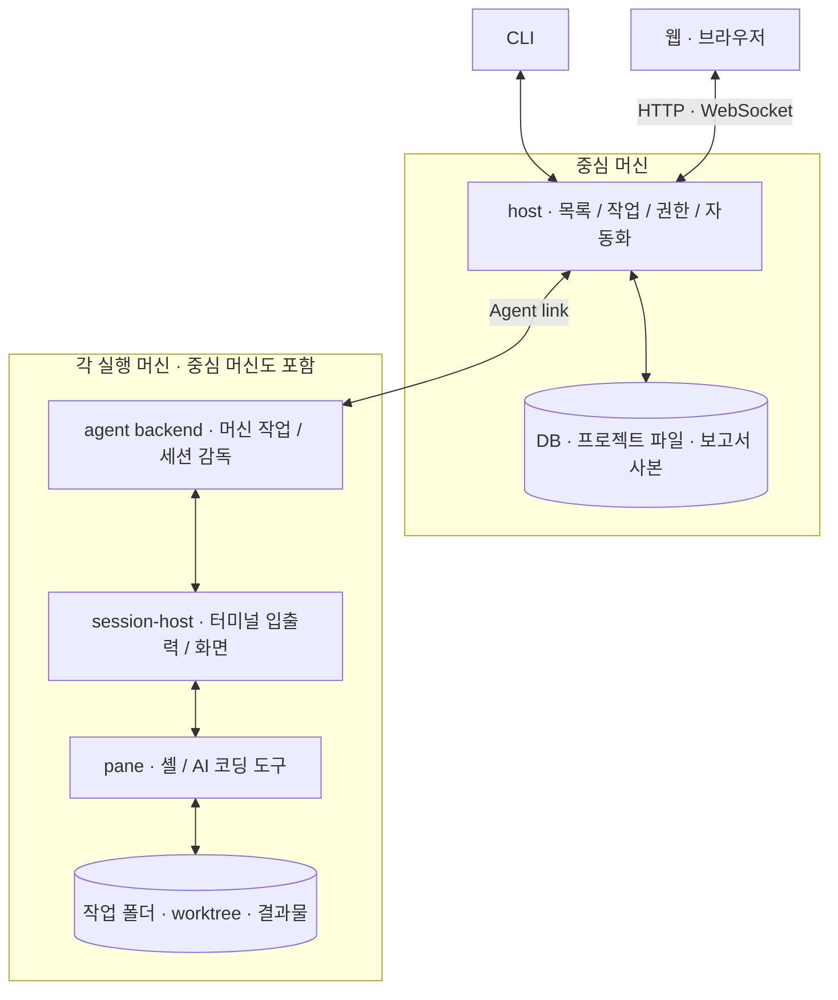
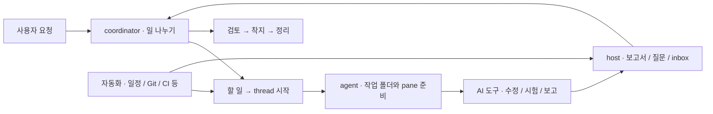

# aaa 구조 지도

aaa는 여러 머신의 AI 코딩 도구와 터미널을 한곳에서 관리한다. **host가 전체 일을 관리하고, 각 머신의 agent backend가 실행을 맡으며, CLI와 웹은 host를 통해 보고 조작한다.** 이 문서는 기능을 추가하거나 고칠 때 어디부터 볼지 안내한다.

## 무엇이 어디서 도는가

host·agent·session-host는 **같은 `aaa` 실행 파일의 서로 다른 역할**이다. AI 코딩 도구(Claude Code·Codex 등)는 pane에서 실행하는 별도 프로그램이다. coordinator와 thread의 일꾼도 이 AI 도구이며, agent backend와는 다르다.

session은 터미널을 묶는 단위이고, 그 안의 workspace·tab·pane은 화면 배치 단위다. session-host가 실제 터미널(PTY)을 유지하므로 웹을 닫아도 작업은 계속된다. host와 agent가 다시 연결되면 상태와 화면을 맞춘다. 웹은 표시용 상태를 갖지만 작업의 정본은 backend에 둔다.

## 코드에서 찾기

아래 경로에서 crate 내부 파일은 `src/` 아래에 있다. backend는 Rust, 웹은 TypeScript·React다.

| 큰 덩어리 | 역할과 코드 위치 |
|---|---|
| CLI·실행 진입점 | [`crates/aaa/src/`](../crates/aaa/src/): `main.rs`가 역할을 나누고 `cli.rs`가 명령을 처리한다. |
| 웹 | [`web/src/`](../web/src/): `App.tsx`가 화면을 묶고 `api.ts`·`apiRequest.ts`가 host와 통신한다. `Term.tsx`는 터미널, `Chat.tsx`는 대화, `TasksView.tsx`·`ReportsView.tsx`는 할 일·보고서 화면이다. |
| host | [`crates/aaa-host/src/`](../crates/aaa-host/src/): `front.rs`·`http.rs`가 요청을 받고 `link.rs`가 agent와 연결한다. `orch.rs`·`coord.rs`·`task_queue/`는 thread·coordinator·할 일을 관리한다. |
| 머신 실행·터미널 | [`aaa-agent`](../crates/aaa-agent/src/)의 `threads.rs`·`command.rs`·`files.rs`가 작업 폴더·명령·파일을 다룬다. [`aaa-session`](../crates/aaa-session/src/)은 프로세스와 터미널 수명, [`aaa-vt`](../crates/aaa-vt/src/)는 터미널 화면 해석을 맡는다. |
| 사건·자동화·결과물 | host의 `inbox.rs`·`post.rs`는 전달과 기록, `automation/`·`routine.rs`·`git_watch.rs`·`ci.rs`는 조건 감시와 실행, `library*.rs`·`report_sandbox.rs`는 보고서 제공을 맡는다. |
| 설정·계정·진단 | [`aaa-config`](../crates/aaa-config/src/)는 TOML 설정과 경로, host의 `accounts.rs`·`account_pool/`·`usage/`는 AI 계정 배정과 사용량을 다룬다. profile은 실행할 도구·모델·인자를 정한다. [`aaa-doctor`](../crates/aaa-doctor/src/)는 환경을 점검한다. |
| 공통 계약·연결 | [`aaa-proto`](../crates/aaa-proto/src/)는 메시지·타입·판 번호, [`aaa-common`](../crates/aaa-common/src/)은 IPC·TLS·클라이언트 등 공통 구현이다. |
| 설치·배포 | CLI의 `install/`·`service.rs`·`update/`, host의 `installation/`·`deploy.rs`·`rollout/`, agent의 `deploy/`가 나눠 맡는다. [`scripts/`](../scripts/)는 빌드·release·검증 도구, [`docs/`](.)는 설계와 사용 절차다. |

## 경계는 어떻게 잇는가

**새 기능은 메시지 계약을 통해 층을 잇는다.** host가 agent·session 구현을 직접 호출하거나 웹이 agent에 직접 붙는 구조로 만들지 않는다.

| 경계 | 연결과 계약 |
|---|---|
| CLI·웹 ↔ host | **Front API**. CLI는 로컬 IPC, 웹은 HTTP·WebSocket을 쓴다. 원격 머신의 CLI 요청도 host로 전달된다. 정본은 `aaa-proto/src/msg.rs`의 `FrontRequest`와 관련 타입이다. |
| host ↔ agent | **Agent link**. 원격 agent가 host로 TCP+TLS 연결을 열고, 같은 머신에서는 로컬 IPC를 쓴다. `aaa-proto/src/msg.rs`의 `AgentRequest`와 사건 타입을 양쪽 `link.rs`가 주고받는다. |
| agent ↔ session-host | **Session IPC**로 터미널을 제어한다. AI 도구의 hook은 로컬 agent에 상태 사건을 전달한다. 실제 실행 상태는 여기서 host로 올라간다. |

계약을 바꾸면 `aaa-proto`의 타입과 [`version.rs`](../crates/aaa-proto/src/version.rs)의 호환성·기능 협상을 함께 검토한다. 웹용 [`web/src/gen/proto.ts`](../web/src/gen/proto.ts)는 생성물이다. 타입·스키마를 다시 생성하고 양쪽 처리 코드, 계약 시험, 설계·시험 문서를 함께 맞춘다. 단순 화면 변경까지 API 판을 올리는 것은 아니다. 역할 사이의 금지 의존은 [`deps.rs`](../crates/aaa/tests/deps.rs)가 검사한다.

## 일은 어떻게 흐르는가

- **프로젝트**는 저장소·지침·기억·할 일을 묶는다. 한 host 인스턴스는 활성 프로젝트 하나를 맡는다. **coordinator**는 무엇을 누구에게 맡길지 판단하고, host는 시작·전달·기록 절차를 실행한다.
- **thread**는 맡긴 일의 단위다. 지시를 담은 brief와 작업 폴더, 실행 pane, 보고서를 잇는다. 코드 작업은 보통 **worktree**(같은 Git 저장소의 별도 작업 사본)에서 하고, 저장소 없는 일은 별도 폴더에서 한다.
- **inbox**는 coordinator가 확인할 사건과 요청을 모은다. **post**는 보고·요청을 전달하는 기록이다. 질문은 웹에서 답하고, **자동화**는 일정이나 Git·CI 변화에 따라 안내를 보내거나 승인된 범위의 thread를 시작한다.
- 일꾼이 `report.md`와 **library**의 그림·문서 등을 만들면 host가 가져와 웹에 보여 준다. 검토 뒤 **착지**는 변경을 기준 브랜치에 합치는 단계다. CI 확인과 작업 공간 정리가 뒤따른다. 구체적인 병합 순서는 프로젝트 운영 규칙으로 정한다.

## 무엇을 저장하고 보호하는가

| 위치 | 보관하는 것 |
|---|---|
| host 상태 폴더·프로젝트 폴더 | SQLite `host.db`의 작업·기기·전달 상태와 프로젝트 지침·기억·할 일·자동화 파일, 회수한 보고서·library 사본 |
| 각 머신의 설정·상태 폴더 | TOML 설정, 연결 신원, 세션 복구 정보·출력 기록. 경로 선택은 `aaa-config/src/paths.rs`가 맡는다. |
| 각 thread의 작업 폴더 | worktree 또는 일반 폴더, brief·보고서 원본·library. 사용자 첨부는 host가 받고 필요한 작업 머신으로 전달한다. |

권한은 host가 확인한다. 머신은 등록 후 서로의 신원을 확인하며 연결하고, 웹 기기는 짝짓기로 보기·조작 권한을 받는다. 공개 HTTPS 화면의 중요한 승인은 **passkey**로 사용자를 확인한다. **safety**는 자동 시작·실행 허용 범위를 정하며, AI의 요청 자체가 사용자 승인을 대신하지 않는다. 관련 코드는 host의 `caller.rs`·`safe_mode/`·`passkey/`에 있다.

보고서 HTML은 앱과 분리된 **sandbox**에서 연다. 자기 보고서 자료만 제한적으로 읽을 수 있고 앱 API·외부 연결·쿠키·저장소에는 접근하지 못한다. 자세한 작성 규칙은 [library 문서](library.md)를 따른다.

**설치**는 실행 파일·설정·머신 등록·OS 서비스 감독자를 준비하는 일이다. **배포**는 검증한 실행 파일로 교체하고 서비스를 재시작해 결과를 확인하는 일이다. 터미널 세션의 수명을 분리해 서비스 교체 때 작업을 지키며, 실패 시 복구 경로를 둔다. [설치 계약](install-contract.md)과 [설치·업데이트·배포 절차](install-runbook.md)에 상세 경계가 있다.

## 고치려는 일에서 출발하기

| 하고 싶은 일 | 따라갈 길 |
|---|---|
| 웹 화면 추가 | `web/src/` 화면 → 기존 API 확인 → 필요하면 proto·host 요청 처리 추가. `web/test/`의 로직 시험과 `web/e2e/`의 실제 화면 흐름, [사용법](usage.md)을 맞춘다. |
| CLI 명령 추가 | `aaa/src/cli.rs` → Front API → host 처리. 머신 실행이 필요하면 Agent link까지 잇고 `crates/aaa/tests/`에서 명령부터 결과까지 확인한다. |
| host 저장 항목 추가 | host의 해당 기능 → `db.rs`·`db/` 또는 프로젝트 파일 저장 코드. 기존 데이터 읽기·재시작 뒤 보존을 시험하고 외부에 보이면 proto도 바꾼다. |
| 머신 동작·터미널 변경 | `aaa-agent` → 필요하면 `aaa-session`·`aaa-vt`. 연결 계약과 OS 차이를 확인하고 해당 crate 시험 및 `crates/aaa/tests/`의 재접속·프로세스 시험을 고른다. |
| 자동화 종류 추가 | host의 `automation/`·`routine.rs` → 조건 감시·실행·승인·기록. 설정 스키마와 웹 편집기를 맞추고 중복 실행·재시작 시험, [자동화 문서](automations.md)를 고친다. |

설계 근거는 [plan.md](plan.md), 시험 선택과 작성 규칙은 [testing.md](testing.md)를 본다. 로컬·CI의 공통 검사 입구는 `scripts/ci-local.sh`이며 공개 전에는 `scripts/check-public.sh`로 내부 정보가 섞이지 않았는지 확인한다.
