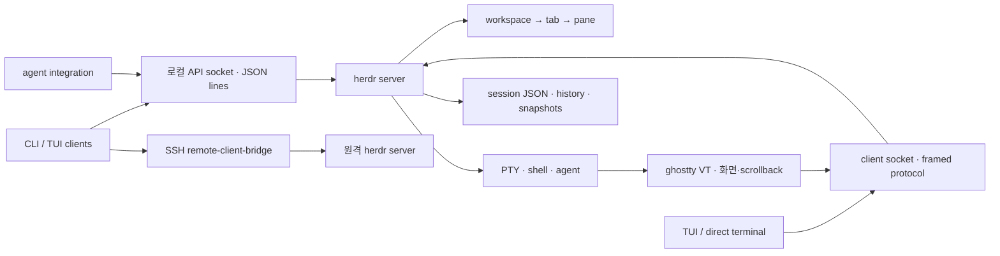
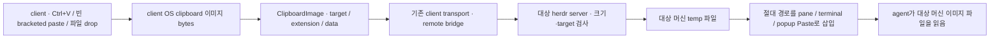
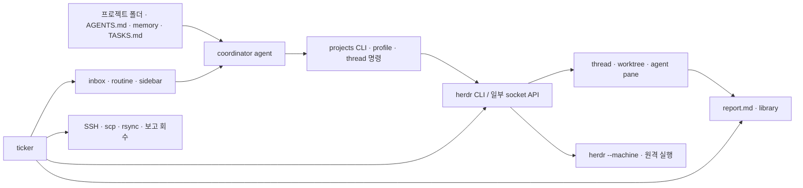
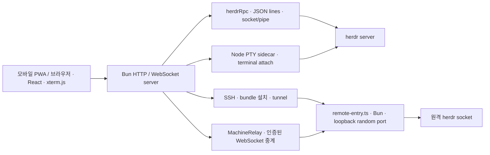

# 조사 근거와 세 도구 분석

조사일: 2026-10-16. 실행·설치 지시를 따라 하지 않고 고정한 소스를 읽었다. 원본은 git에서 제외한 `research/`에 있다. herdr-projects는 **v0.2.35만** 받아 분석했다. 다른 계열의 코드는 참고하지 않았다.

**개정(2026-10-16, 독립 검토 반영).** 검토의 사실 대조에서 「틀림」 2건과 「부분」 10건이 나왔다. 해당 문장을 본문에서 직접 고쳤고, 근거 줄(`파일:줄`)을 붙였다. 새로 찾은 사항(herdr Windows native GA, 감지 manifest 자동 갱신, web-ui의 Tailscale HTTPS 공개 방식, 라이선스 세부)도 보탰다. 반영 여부 전체는 [기획서 부록 B](plan.md#부록-b-검토-지적-반영표)에 있다.

## 출처와 고정 버전

| 구분 | 출처 | 받은 버전·commit | 라이선스 |
|---|---|---|---|
| herdr | [공식 저장소](https://github.com/herdrdev/herdr/tree/v0.9.5) | v0.9.5, `2ecf19a92fc3a7fff75b6ce3655ef04f4625ec01` | Apache-2.0 |
| herdr-projects | [지정 tag](https://github.com/eliasstravik/herdr-projects/tree/v0.2.35) | v0.2.35, `1f05c002f22c8355733c567ef47c511612bcdb1f` | MIT |
| herdr-web-ui | [고정 commit](https://github.com/devswha/herdr-web-ui/tree/aa624cb56f550f9a7dd8bf4d59ed99ffc3921741) | 0.4.10, remote runtime v29, `aa624cb56f550f9a7dd8bf4d59ed99ffc3921741` | MIT |
| 별도 보조 조사: mobile-relay | [설치본과 같은 tag](https://github.com/0cv/herdr-mobile-relay/tree/v0.21.3) | 0.21.3, `a58f1fc63469995534f4ae7de8e55220ce10ffaa` | **AGPL-3.0-or-later** |

공식 사이트의 저장소 연결로 herdr의 출처를 확인했다. mac-c 설치된 projects checkout도 `1f05c002…`였다. mac-a의 `~/.local/share/herdr-web-ui/remote-v29`는 `remote-v29-5c20f56c2190819f`를 가리켰다. 그 아래 server의 TypeScript 파일 100개를 복사하여 공개 저장소와 비교했고 **100개 모두 바이트 단위로 일치**했다. 따라서 설치 소스로만 추정한 분석이 아니다. mac-b mobile-relay의 release-manifest도 위 revision·darwin/arm64를 명시한다.

원격 운영 자료는 mac-b의 `~/.herdr-projects/projects/memory/{machines,preferences}.md`와 `library/t-0087/index.html`, `library/t-0088/index.html`을 SSH로 읽어 사본을 남겼다. 비밀 파일, 설정 전체, 인증서·키체인 항목은 가져오지 않았다.

## herdr 0.9.5



- **기동·수명.** 단일 Rust 실행 파일에 CLI/client/server가 함께 있다. TUI 자동 감지 경로는 서버가 없을 때 별도 프로세스를 띄우며 `setsid`, stdio 분리를 적용한다. client detach는 pane을 종료하지 않는다. server 종료나 머신 재부팅은 실제 실행 중인 명령을 보존하지 못한다. Windows는 `DETACHED_PROCESS`로 띄우고, 부모가 kill-on-close Job 안에 있으면 WMI로 Job 밖에서 띄운다(`src/platform/windows.rs:1364-1369, 1536-1540`). herdr는 Windows native(ConPTY) 서버를 release 대상으로 GA 지원한다(`.github/workflows/release.yml:101-103`). Windows client clipboard 처리도 있다(`windows.rs:2823-2867`). aa Windows agent backend 설계의 참고 구현이다. 근거: [autodetect.rs](https://github.com/herdrdev/herdr/blob/v0.9.5/src/server/autodetect.rs)(`:305-340`), [platform/mod.rs](https://github.com/herdrdev/herdr/blob/v0.9.5/src/platform/mod.rs)(`:293-308`).
- **계층.** workspace는 프로젝트·checkout 단위, tab은 레이아웃 묶음, pane은 터미널 표현이다. terminal ID와 pane ID를 분리해 pane 이동과 터미널 수명을 구분한다. 다중 client와 화면 변경분 전송, 별도 terminal attach가 있다.
- **API·CLI.** `pane run/read/send-keys`, `workspace list`, agent 시작·상태·대기 등을 JSON request로 보낸다. brief의 `pane keys`에 대응하는 소스의 정식 명령은 `pane send-keys`다. 명령 표기는 해당 버전 CLI로 확인해야 한다. API는 로컬 socket, Unix 권한 0600이며 초기 request 제한은 1MiB다. 화면/client 프로토콜은 u32LE 길이 + bincode, protocol 22다. frame 상한 2MiB는 **handshake 메시지에만** 적용되고, 그 뒤 client 메시지 상한은 32MiB다(`src/server/client_transport.rs:692, 1011-1016`). endpoint generation 1은 내부 binary protocol과 따로 호환성을 관리한다. 근거: [API server](https://github.com/herdrdev/herdr/blob/v0.9.5/src/api/server.rs), [pane CLI](https://github.com/herdrdev/herdr/blob/v0.9.5/src/cli/pane.rs), [wire](https://github.com/herdrdev/herdr/blob/v0.9.5/src/protocol/wire.rs), [endpoint](https://github.com/herdrdev/herdr/blob/v0.9.5/src/protocol/endpoint.rs).
- **머신.** `machine add/list`로 저장한 머신을 `--machine`으로 선택한다. SSH stdio bridge가 원격 client socket으로 바이트를 전달한다. 중요한 결함은 `ensure_remote_server_running`이 서버 부재 시 **SSH 안에서 자동 기동**한다는 점이다. 웹이나 원격 클라이언트가 먼저 접근하면 잘못된 책임 프로세스·보안 세션으로 서버가 생길 수 있다. 근거: [remote/host.rs](https://github.com/herdrdev/herdr/blob/v0.9.5/src/remote/host.rs).
- **상태 감지.** 프로세스 식별과 화면 패턴, 잠깐의 idle 전환을 억제하는 확인 절차를 결합한다.
  - 프로세스 식별은 `src/detect/mod.rs:245-290`이고, 화면 규칙은 `src/detect/manifests/*.toml`이다. `agent_detection.rs`는 idle 전환 억제만 맡는다.
  - Claude hook v11과 Codex hook v10은 모두 **SessionStart에서 session ID만** 보고한다(`src/integration/targets.rs:195-201`). 턴 시작·끝, 질문, 오류는 hook으로 오지 않는다. 그래서 aa는 harness별 사건 출처를 따로 정해야 한다(plan §8.3).
  - 화면 기반 working/blocked 판정과 hook 정보를 같은 신뢰도로 취급하면 안 된다.
  - 서버는 감지 manifest를 `https://herdr.dev/agent-detection/index.toml`에서 자동으로 갱신한다(`src/detect/manifest_update.rs:16`). aa는 감지 규칙을 버전 pin하고 원격 자동 갱신을 하지 않는다.
  - 근거: [detect/mod.rs](https://github.com/herdrdev/herdr/blob/v0.9.5/src/detect/mod.rs), [agent_detection.rs](https://github.com/herdrdev/herdr/blob/v0.9.5/src/pane/agent_detection.rs), [Codex hook](https://github.com/herdrdev/herdr/blob/v0.9.5/src/integration/assets/codex/herdr-agent-state.sh), [Claude hook](https://github.com/herdrdev/herdr/blob/v0.9.5/src/integration/assets/claude/herdr-agent-state.sh).
- **복원.** `session.json`, `session-history.json`, `session-snapshots/`(48개 보관), `plugins.json`을 분리한다. 복원은 저장한 cwd에서 새 shell을 만들고 agent session ID 또는 보고된 resume argv로 재개한다. 원래 프로세스·빌드의 연속 실행을 뜻하지 않는다. 사용자 운영 기록에는 기본 resume가 model/effort/권한 옵션을 잃은 사례가 있다. 반면 소스에는 검증한 custom resume argv 경로도 있다. 새 설계는 실행 스펙과 resume 스펙을 명시적으로 함께 보존해야 한다. 근거: [restore](https://github.com/herdrdev/herdr/blob/v0.9.5/src/persist/restore.rs), [writer](https://github.com/herdrdev/herdr/blob/v0.9.5/src/persist/writer.rs), [agent_resume](https://github.com/herdrdev/herdr/blob/v0.9.5/src/agent_resume.rs).
- **플러그인.** TOML manifest의 build/startup/actions/events/panes를 외부 명령으로 실행한다. env에 plugin·workspace·pane·socket 문맥을 준다. 프로세스 제한·출력 제한은 있으나 임의 프로그램을 실행하는 신뢰 모델이다. 확장 개념은 가져오되 초기부터 플러그인 설치·자기 갱신까지 복제하지 않는다. 근거: [manifest](https://github.com/herdrdev/herdr/blob/v0.9.5/src/app/api/plugins/manifest.rs), [runtime](https://github.com/herdrdev/herdr/blob/v0.9.5/src/app/api/plugins/runtime.rs).
- **macOS 문맥.** `setsid`의 detached 여부와 Mach bootstrap 문맥, TCC 책임 프로세스, 키체인 상태는 별개다. herdr는 자동 기동 서버를 per-user bootstrap으로 옮기는 private API도 쓴다. `getsid()==pid`를 모든 플랫폼의 건강 판정으로 가져오면 안 된다. 근거: [bootstrap](https://github.com/herdrdev/herdr/blob/v0.9.5/src/platform/macos/bootstrap.rs).

가져올 것: 실제 PTY, workspace/tab/pane, terminal 수명 분리, CLI와 API의 같은 기능 범위, snapshot+event, session identity, bounded output. 버릴 것: 접근자가 서버를 임의로 자동 기동하는 경로, 내부 bincode enum에 공개 호환성을 의존하는 방식, 책임 계보를 운영자가 매번 복구해야 하는 방식.

### 이미지 붙여넣기 소스 확인

사용자 추가 지시에 따라 같은 **v0.9.5 commit**의 다음 경로를 확인했다. 실제 clipboard를 읽거나 운영 pane에 이미지를 입력하지 않았으며, 이 절은 코드 분석이다.



| 확인 항목 | 소스에서 확인한 내용 |
|---|---|
| trigger·원격 구분 | [client/clipboard_images.rs](https://github.com/herdrdev/herdr/blob/v0.9.5/src/client/clipboard_images.rs)의 `endpoint_accepts_local_images`는 원격 client/endpoint 및 활성 surface를 요구한다. `should_bridge_clipboard_image_paste`는 기본 설정 Ctrl+V와 빈 bracketed paste를 판별하며, Windows는 대응하는 input event를 처리한다. 로컬 endpoint의 모든 Ctrl+V를 이 bridge가 처리한다고 해석하면 안 된다 |
| 실제 입력 처리 | [client/mod.rs](https://github.com/herdrdev/herdr/blob/v0.9.5/src/client/mod.rs)에서 이미지 수집 성공 시 `write_remote_image_to_server` 후 원래 key 전송을 건너뛴다. 이미지가 없으면 일반 입력으로 계속 진행한다. 원격 terminal에 붙일 로컬 image-file 경로 drop도 파일 bytes를 읽어 보낸다 |
| macOS 수집 | [platform/macos.rs](https://github.com/herdrdev/herdr/blob/v0.9.5/src/platform/macos.rs)의 `read_clipboard_image`는 osascript로 PNGf clipboard를 `herdr-clipboard-image-<pid>-<nanos>.png`에 잠시 저장하고 bytes를 읽은 뒤 이 **client-side** 파일을 지운다. 아래 server staging 파일과 다른 단계다 |
| 다른 OS 수집 | [platform/windows.rs](https://github.com/herdrdev/herdr/blob/v0.9.5/src/platform/windows.rs)는 OpenClipboard·등록 PNG format·CF_DIBV5/CF_DIB→PNG 경로다. [platform/linux.rs](https://github.com/herdrdev/herdr/blob/v0.9.5/src/platform/linux.rs)는 wl-paste/xclip과 환경 DISPLAY/WAYLAND_DISPLAY를 사용한다. 이는 **client clipboard 수집**에 필요하며 원격 agent 머신의 clipboard를 공유하는 방식이 아니다 |
| wire·크기 | [protocol/wire.rs](https://github.com/herdrdev/herdr/blob/v0.9.5/src/protocol/wire.rs)에 `ClientMessage::ClipboardImage`의 target/extension/data와 `MAX_CLIPBOARD_IMAGE_PAYLOAD=16MiB`가 있다. 초과 payload를 받으면 [server/client_transport.rs](https://github.com/herdrdev/herdr/blob/v0.9.5/src/server/client_transport.rs)가 오류 응답 없이 **client 연결을 끊는다**(`:1119-1127`). client 쪽은 상한을 넘는 이미지면 그 키 입력을 버린다(`src/client/clipboard_images.rs:18-26`). aa는 이 동작을 가져오지 않고 명시 오류와 draft 유지로 바꾼다 |
| 저장 경로·권한 | [server/clipboard_image.rs](https://github.com/herdrdev/herdr/blob/v0.9.5/src/server/clipboard_image.rs)의 `stage`가 `<temp>/herdr-clipboard-images-<euid>/client-<client_id>-clipboard-<nanos>-<attempt>.<extension>`을 create_new로 만든다. PNG 수집이면 `.png`, 지원 확장자는 png/jpg/gif/webp/bmp이고 모르는 확장자는 png로 강제한다(`:69-70`). 트리거 키는 설정 `keys.remote_image_paste`다(`src/config/model.rs:1148`). Unix는 directory 0700/file 0600, Windows suffix는 UID가 아니라 **server PID**이며 이 파일의 restrict 함수는 no-op다 |
| agent 입력 | [server/headless.rs](https://github.com/herdrdev/herdr/blob/v0.9.5/src/server/headless.rs)의 `ClientClipboardImage` 처리와 `paste_client_clipboard_image_path`가 target을 검증하고 **server-local 절대 경로**를 Pane Paste·Popup Paste 또는 DirectTerminal 입력으로 넣는다. [terminal_attach.rs](https://github.com/herdrdev/herdr/blob/v0.9.5/src/server/terminal_attach.rs)는 terminal mode에 따른 paste payload를 만든다. 이미지 전송을 sixel/terminal graphics 렌더링과 혼동하지 않는다 |
| 수명·한계 | 성공 staging 파일을 client의 staged_clipboard_files에 기록하고 client disconnect 때 지운다. 추가 stage 때 24시간 이상 된 파일도 정리한다. 따라서 client 수명과 agent의 지연 파일 읽기·resume 수명이 일치한다고 보장할 수 없다. 확장자 sanitize 자체는 수신 이미지 bytes의 완전한 decode 검증이 아니다 |

새 aa 계획에서는 수집은 front, 전달은 host(저장하지 않고 통과), 검증·파일 생성은 **대상 머신의 agent backend**, 입력 형식은 harness adapter가 소유한다. front는 agent backend에 직접 붙지 않는다. local/remote를 같은 attachment API로 처리하고 SHA256·길이 receipt 후만 경로를 입력한다. 경로만 다른 머신으로 보내지 않고 bytes를 전송한다. client detach만으로 파일을 삭제하지 않으며 session/thread 참조·보관 정책을 둔다. Windows는 명시적 SID ACL, 세 OS native 경로·인용·이미지 소비 E2E를 적용한다. 이는 제품 구현이 아닌 [기획서의 필수 기능·아키텍처·검증 계획](plan.md)이다.

## herdr-projects v0.2.35



프로젝트 폴더가 coordinator의 문맥이다. coordinator는 평범한 agent이며 결정은 문맥·skill을 따라 한다. 바이너리는 thread 생성, 보고 복사, 상태 분류, resolve 같은 결정적인 절차를 맡는다. 별도 프로젝트 데이터베이스는 없다. ticker는 별도 상주 루프이며, 도달할 수 있는 세션이 5분 동안 없으면 스스로 종료한다(`src/ticker.rs:29, 272-274`). 근거: [operations](https://github.com/eliasstravik/herdr-projects/blob/v0.2.35/docs/operations.md).

| 관심 항목 | 확인한 동작 | 새 프로그램에서의 선택 |
|---|---|---|
| profile | 이름·description·harness·model·effort·args, 허용 목록(`src/profiles.rs:65-71`); 로컬과 원격 정의가 다를 수 있고, 원격 resolve는 name·agent·args만 돌려준다(`src/remote.rs:113-120`) | 이름뿐 아니라 실제 해석 결과와 revision을 thread에 저장 |
| coordinator | 프로젝트 cwd로 발견; context를 매 turn 읽음 | 프로젝트 폴더·AGENTS.md·memory 중심 유지, event cursor 추가 |
| ticker | 기본 15초, brief 2초(`src/ticker.rs:22,24`), 원격은 4 tick마다(약 1분, `src/steps.rs:97` `REMOTE_EVERY_TICKS = 4`); cheap pass 먼저, 느린 복사 뒤 | event subscription 우선 + 제한된 reconciliation timer |
| inbox | timestamp·kind·subject·counter 이름의 Markdown; 처리 완료 별도 폴더 | 잃지 않는 이벤트/ack, Markdown은 읽을 수 있는 투영으로 유지 |
| routine | every/daily·prompt·명령; 정확한 명령 내용 승인, DST 고려 | 동일 개념, 실행 ID·기한·missed-run 정책을 명시 |
| report | thread의 report hash가 달라지면 home에 복사; library 상한·symlink 검사 | hash 확인한 원자적 publish 후 review 이벤트; 파일 기록 유지 |
| 원격 thread | herdr CLI 호출을 `--machine`으로 전달, profile은 SSH로 원격 resolve. 단 socket 직접 호출(`agent.view.set`·`workspace.move`)에는 machine이 없다(`src/herdr.rs:562-591`) | 공통 typed agent API; 양쪽 profile 정책 검증 |
| placement | 원격은 repo가 있는 worktree만 허용; tab/checkout 원격 금지 | 원격 repo 없는 작업도 machine-local task dir에서 실행 |
| 상태 | starting/open/failed/resolved와 표시 group이 따로 있음 | 실행 상태·agent 관측 상태·검토 상태·연결 상태를 분리 |
| 정리 | report/library 최종 회수 후 worktree 제거; 불완전 복사는 보존 | receipt 검증 후만 정리, dirty worktree를 강제로 삭제하지 않음 |
| hook | SessionStart/UserPromptSubmit/PostToolUse에서 **progress 보고 지침과 리마인더만** 주입한다(`src/progress.rs:279-302, 326-355`). context를 주입하지 않는다. 대상 harness는 claude·codex·droid·gemini·copilot 5개(`src/setup.rs:39-53`). 설치 변경은 `owned.json` journal로 되돌린다 | 작은 native hook CLI, 범위·세션 token 확인, 기존 설정 자동 변형 최소화, journal 방식 계승 |

직접 확인한 핵심 소스: [herdr.rs](https://github.com/eliasstravik/herdr-projects/blob/v0.2.35/src/herdr.rs)(socket binding·on_machine), [threads.rs](https://github.com/eliasstravik/herdr-projects/blob/v0.2.35/src/threads.rs)(remote profile·placement·brief), [remote.rs](https://github.com/eliasstravik/herdr-projects/blob/v0.2.35/src/remote.rs)(resolve_profile·SSH 인용·report hashes·copy), [ticker.rs](https://github.com/eliasstravik/herdr-projects/blob/v0.2.35/src/ticker.rs), [thread.rs](https://github.com/eliasstravik/herdr-projects/blob/v0.2.35/src/thread.rs), [inbox.rs](https://github.com/eliasstravik/herdr-projects/blob/v0.2.35/src/inbox.rs), [routine.rs](https://github.com/eliasstravik/herdr-projects/blob/v0.2.35/src/routine.rs), [setup.rs](https://github.com/eliasstravik/herdr-projects/blob/v0.2.35/src/setup.rs).

상태 파일 배치:

```text
~/.herdr-projects/<project>/
  PROJECT.md, AGENTS.md, MEMORY.md, memory/, TASKS.md, routines/
  threads/<id>.toml, <id>.md, <id>.task.md, <id>.next.md
  inbox/, inbox/done/, library/<id>/, .state/
<thread cwd>/.herdr-project/<project>-<id>/brief.md, report.md, library/
~/.herdr-projects/.ticker.lock, .ticker.log, .progress/
~/.config/herdr-projects/config.toml, owned.json, approved-routines.json
```

`Herdr::cmd`가 저장 socket을 env에 넣고 inherited HERDR_SESSION을 제거하는 점은 다중 세션 오접속 방지에 좋다. 반면 각 요청에서 CLI 프로세스를 만들고, 원격 profile·해시·보고 복사에 별도 SSH/scp/rsync가 필요하다. 동일 OS·POSIX 도구를 전제로 한 절차를 Windows에 그대로 옮길 수 없다. plugin manifest의 지원 플랫폼도 macos/linux다. 원격 셸 스크립트 대신 agent binary의 typed API로 경로·파일 회수·실행을 처리한다.

보존할 중요한 운영 철학은 **보고는 파일, 프롬프트는 알림**이다. 놓친 nudge 때문에 결과를 잃지 않아야 한다. 안전 설정은 같은 사용자 shell을 가진 agent에 대한 강한 보안 경계가 아니므로 새 프로그램도 profile 허용 목록을 sandbox라고 부르지 않는다.

## herdr-web-ui 0.4.10 / remote-v29



- Bun이 API·WebSocket과 정적 frontend를 제공하고, React/Vite/xterm.js가 브라우저 화면을 만든다. transcript reader로 agent 대화를 chat 형태로 표시하고 실제 terminal로 전환한다.
- `server/herdr/client.ts`는 Bun.connect로 **JSON 한 줄/요청 한 연결**을 보낸다. Unix socket과 Windows named pipe/marker 차이를 처리한다. terminal attach는 Node + `@lydell/node-pty` sidecar로 실행하며 흐름 제어를 제공한다. herdr가 attach를 못 하거나(Windows) sidecar(Node, node-pty)가 없으면 화면 mirror로 대신한다(`server/index.ts:510-514, 1293`, `server/mirror.ts:1-3`). 세 OS 동일 기능이라고 추정하지 않았다.
- `remote-entry.ts`는 SSH로 기동되어 고정 bundle의 Bun에서 실행된다. 원격 loopback의 임의 port와 난수 token을 descriptor에 남긴다. server가 없으면 Unix는 detached·setsid 없이 `Bun.spawn().unref()`로 herdr server를 띄우고(`server/remote-entry.ts:85-89`), Windows는 SSH/Bun job에 묶이지 않도록 WMI로 띄운다. 웹 서버의 원격 머신 자동 재연결도 사용자 승인 없이 bridge를 띄운다. 이 앱이 관리하던 머신이면 bridge descriptor가 없을 때(예: 재부팅 뒤) 승인 job 없이 `host.start`를 부르고(`server/machines.ts:655-666`), 그 bridge가 herdr가 없으면 위 경로로 띄운다. 설치·갱신이 필요할 때만 승인을 묻는다(`:596-604`). 원격 PATH에 herdr가 없으면 bundle에 든 herdr 0.9.3을 쓴다(`scripts/build-remote-bundle.ts:134`). **macOS에서 이 자동 기동이 10-16 운영 사고와 직접 연결된다.**
- MachineRelay는 인증된 원격 WebSocket을 중계하고 xterm 처리 ACK를 통과시킨다. 출력량·정체 시간을 제한하고 overload는 명시 종료한다. 느린 모바일이 전체 PTY를 무한히 막지 않도록 bounded buffer와 재동기화가 필요하다.
- 인증은 shared token, HttpOnly·SameSite cookie, TLS에서 Secure, 장치별 pairing/권한, Tailscale identity를 조합한다. 빈 token이 곧 항상 안전함을 뜻하지 않으며 `access.ts`의 위치·identity 정책을 함께 봐야 한다. 빈 token으로 loopback이 아닌 주소에 bind하면 pairing 전까지 누구나 drive 권한을 얻는다(`server/access.ts:183`). Origin 검사·변경 권한 재확인이 있고, pairing 시도는 5회부터 backoff한다(`server/auth.ts:38-40`). 새 설계에서는 loopback에서도 웹 요청을 인증하고 proxy identity는 쓰지 않는다(아래 Tailscale 절).
- 모바일은 단순 CSS 축소를 넘는다. 입력용 composer(`TerminalInput.tsx`), 보조 키 막대(`KeyBar.tsx`), IME composition 처리, 키보드 때문에 변하는 viewport(`src/lib/viewport.ts`), touch/pinch·고정 grid·비활성 tab의 resize 억제가 들어 있다. `PhonePanel.tsx`는 모바일 UI가 아니라 Settings → Phone의 Tailscale 주소·QR 안내 패널이다(`src/components/PhonePanel.tsx:21`). 초기 aa도 터미널만 작게 넣으면 모바일 사용성이 충족되지 않는다.
- 이번 aa MVP에 아직 넣지 않은 web-ui 기능: Web Push, PWA, wake lock, CommandPalette, pane 찾기, 끊긴 뒤 draft 보존. Push·PWA는 HTTPS 공개와 함께 M1-4·M3에 배치했다(plan §14).
- **웹 이미지 paste.** Composer의 `onPaste`가 clipboardData file items를 모아 업로드하고 `imageMention`으로 `@path`를 초안에 넣는다. PaneTerminal의 terminal paste는 text-only 동작을 유지하며 file-only paste를 업로드한 뒤 경로를 붙인다. `useMachineApi`가 업로드 시점의 machine ID를 묶고 `/api/machines/<id>/pane/image`를 machine API가 원격 bridge의 `/api/pane/image`로 proxy한다. 실제 파일은 **대상 머신**의 `<pane cwd>/.herdr-web-ui/paste-<stamp>-<uuid 앞 8자>.<ext>`에 0600으로 쓴다. 이미지가 아닌 파일은 원래 이름을 바탕으로 이름을 짓고, 디렉터리는 기본 mode로 만든다. cwd가 없으면 `<tmpdir>/herdr-web-ui/.herdr-web-ui`로 fallback하고, HERDR_WEB_PASTE_DIR override가 있다(`server/paste.ts:88-141`). 터미널에는 POSIX 작은따옴표로 감싼 경로를 넣는다(`src/components/PaneTerminal.tsx:1443`). 웹 제한은 32MiB이고 base64 JSON body를 사용하므로 herdr native bridge의 16MiB와 같은 경로·제한이 아니다. aa는 streaming binary upload·공통 정책을 추천하며 agent별로 검증하기 전 `@path`나 POSIX single quote를 보편 규칙으로 가져오지 않는다.

근거: [index.ts](https://github.com/devswha/herdr-web-ui/blob/aa624cb56f550f9a7dd8bf4d59ed99ffc3921741/server/index.ts), [herdr/client.ts](https://github.com/devswha/herdr-web-ui/blob/aa624cb56f550f9a7dd8bf4d59ed99ffc3921741/server/herdr/client.ts), [pty/session.ts](https://github.com/devswha/herdr-web-ui/blob/aa624cb56f550f9a7dd8bf4d59ed99ffc3921741/server/pty/session.ts), [remote-entry.ts](https://github.com/devswha/herdr-web-ui/blob/aa624cb56f550f9a7dd8bf4d59ed99ffc3921741/server/remote-entry.ts), [machine-relay.ts](https://github.com/devswha/herdr-web-ui/blob/aa624cb56f550f9a7dd8bf4d59ed99ffc3921741/server/machine-relay.ts), [auth.ts](https://github.com/devswha/herdr-web-ui/blob/aa624cb56f550f9a7dd8bf4d59ed99ffc3921741/server/auth.ts), [access.ts](https://github.com/devswha/herdr-web-ui/blob/aa624cb56f550f9a7dd8bf4d59ed99ffc3921741/server/access.ts), [TerminalInput.tsx](https://github.com/devswha/herdr-web-ui/blob/aa624cb56f550f9a7dd8bf4d59ed99ffc3921741/src/components/TerminalInput.tsx).

가져올 것: terminal/chat 전환 개념, 모바일 입력, 읽기/조작 권한, output ACK와 제한, 기기별 연결 상태, Tailscale HTTPS 공개 절차. 줄일 것: Bun→Node→herdr의 다층 실행, 웹 서버의 agent 서버 자동 설치·기동, `Tailscale-User-Login` 헤더 자동 입장, 거대한 vendor별 transcript 파서를 MVP에 모두 포함하는 범위. aa에서는 host 프로세스 안의 Rust 웹 서버가 Front API를 투영하고, PTY는 만들지 않는다.

### Tailscale HTTPS 공개 방식

aa는 이 방식을 그대로 가져온다(plan §6.3, 결정 6의 예외).

| 항목 | web-ui 0.4.10 동작 | 근거 |
|---|---|---|
| 상태 읽기 | `tailscale status --json`과 `tailscale serve status --json`만 읽는다. 서버는 `serve`·`up` 같은 변경 명령을 쓰지 않는다. 각 명령의 timeout은 2.5초다 | `server/tailscale.ts:1-6, 11, 105-108` |
| CLI 위치 | PATH의 `tailscale`, 없으면 App Store 판의 `/Applications/Tailscale.app/Contents/MacOS/Tailscale` | `server/tailscale.ts:13, 88-90` |
| 후보 포트 | 443, 8443, 7317, 17317. serve status의 TCP에 이미 있는 포트는 건너뛴다. 이미 웹 포트를 proxy하는 HTTPS가 있으면 그 주소를 쓴다 | `server/tailscale.ts:15, 75-84` |
| 공개 | `phone` 명령(설치 스크립트나 사람이 실행)만 `tailscale serve --bg --yes --https=<포트> http://127.0.0.1:<port>`를 실행한다. 180초 기다린다. 서버와 기동 경로는 이것을 부르지 않는다 | `scripts/plugin.ts:502-545`, `:55` |
| 되돌리기 | `tailscale serve --https=<포트> off`를 안내한다. `serve reset`을 쓰지 않는다 | `scripts/plugin.ts:553` |
| 주소 | MagicDNS 이름. 인증서가 이름에 대해 발급되므로 100.x IP로 열면 경고가 난다 | `scripts/plugin.ts:557-558` |
| 없음·로그인 전 | `missing`(설치 안내)과 `stopped`(`tailscale up` 안내)를 구분해 보여 준다 | `scripts/plugin.ts:518-528` |
| 웹 bind | 기본 `HOST=127.0.0.1` | `server/index.ts:563` |
| 헤더 입장 | loopback 요청에 `Tailscale-User-Login`이 있고 `X-Forwarded-For`가 tailnet IP이며 PC 소유자와 같으면 pairing 없이 drive 권한 | `server/access.ts:163-171`, `server/index.ts:1846` |

aa는 마지막 행만 가져오지 않는다. serve가 loopback으로 proxy하므로 같은 머신의 다른 프로세스가 같은 헤더를 붙여 보낼 수 있고, 결정 6이 tailnet 신원 사용을 뺐기 때문이다. aa의 후보 포트는 herdr-web-ui와 겹치지 않게 443·8443·7443·17443으로 둔다. 참고로 web-ui는 사용량 표시를 위해 `gui/<uid>` 일회성 launchd job으로 키체인 항목을 읽는다(`server/usage.ts:774-786`). GUI 세션 문맥이 키체인 접근에 필요하다는 운영 관찰과 같은 방향이다.

이미지 흐름 추가 근거: [Composer.tsx](https://github.com/devswha/herdr-web-ui/blob/aa624cb56f550f9a7dd8bf4d59ed99ffc3921741/src/components/Composer.tsx), [PaneTerminal.tsx](https://github.com/devswha/herdr-web-ui/blob/aa624cb56f550f9a7dd8bf4d59ed99ffc3921741/src/components/PaneTerminal.tsx), [compose.ts](https://github.com/devswha/herdr-web-ui/blob/aa624cb56f550f9a7dd8bf4d59ed99ffc3921741/src/lib/compose.ts), [machineContext.tsx](https://github.com/devswha/herdr-web-ui/blob/aa624cb56f550f9a7dd8bf4d59ed99ffc3921741/src/lib/machineContext.tsx), [api.ts](https://github.com/devswha/herdr-web-ui/blob/aa624cb56f550f9a7dd8bf4d59ed99ffc3921741/src/lib/api.ts), [machine-api.ts](https://github.com/devswha/herdr-web-ui/blob/aa624cb56f550f9a7dd8bf4d59ed99ffc3921741/server/machine-api.ts), [paste.ts](https://github.com/devswha/herdr-web-ui/blob/aa624cb56f550f9a7dd8bf4d59ed99ffc3921741/server/paste.ts), [attachments.ts](https://github.com/devswha/herdr-web-ui/blob/aa624cb56f550f9a7dd8bf4d59ed99ffc3921741/shared/attachments.ts).

## mac-b mobile-relay는 별도 제품이다

설치본의 README와 manifest를 확인한 뒤 같은 v0.21.3 소스를 별도로 받았다. Go server, Svelte frontend, per-device controller/reader, 암호화 WebSocket·gateway·WebRTC 경로를 쓴다. herdr-web-ui의 `MachineRelay`와 이름이 비슷하지만 코드·라이선스·배포가 다르다. Native Windows는 이 버전의 지원 대상이 아니다.

외부 gateway까지 다루는 E2EE/NAT 우회 기능은 현재 사용자 네트워크의 기본 요구에 넣지 않는다. AGPL 코드·frontend·protocol 구현을 MIT 프로젝트에 섞지 않고, 장치 취소·권한·연결 상태 같은 일반 개념만 참고한다. 향후 그 코드를 실제로 가져오려면 별도 라이선스 결정과 해당 의무 검토가 먼저 필요하다. 근거: [LICENSE](https://github.com/0cv/herdr-mobile-relay/blob/v0.21.3/LICENSE), [transports](https://github.com/0cv/herdr-mobile-relay/blob/v0.21.3/docs/transports.md), [deviceauth](https://github.com/0cv/herdr-mobile-relay/blob/v0.21.3/internal/deviceauth/store.go).

## 기존 스택 비교와 재사용 범위

| 계층 | herdr 0.9.5 | projects 0.2.35 | web-ui 0.4.10 | aa 추천 |
|---|---|---|---|---|
| 언어·실행 | Rust, Tokio+threads | Rust, 동기 명령·ticker | Bun TS + Node sidecar | Rust 단일 실행 파일(역할 host·agent·session-host), TS 웹 front |
| 터미널 | portable-pty vendor, ghostty-vt, Ratatui/Crossterm | herdr CLI 호출 | xterm.js, node-pty, Windows mirror | portable-pty+플랫폼 adapter, ghostty-vt adapter, Ratatui, xterm.js |
| 연결 | local socket/pipe, JSON API, binary client, SSH | herdr --machine + ssh/scp/rsync | HTTP/WS, SSH bridge, relay | Front API(front ↔ host)와 Agent link(agent가 host에 TCP+TLS 1.3로 연결, 상호 고정 키). SSH·tailnet 비의존 |
| 상태 | JSON snapshot/history | Markdown/TOML/JSON+lock | 파일 기반 기기·환경설정, transcript store 읽기 | SQLite 상태·event outbox + Markdown 문맥·보고 |
| 웹 | 자체 서버 없음 | popup/sidebar | React 19, Vite, Bun.serve | React/Vite/xterm.js + Rust Axum |
| 배포 | 플랫폼별 단일 binary, Zig VT 빌드 | plugin binary, macos/linux | Bun/Node/bundle 조합 | OS/arch별 `aa` 하나, Mac은 고정 경로 `aa.app`, ed25519 서명 manifest |

herdr의 VT binding은 Apache-2.0이고 내부 libghostty-vt는 MIT다. vendor metadata의 upstream commit은 `44f2a44df7e8c4a0c6df3f7d872ef3d7ead88e51`이며 이 소스는 Zig 0.16.0을 요구한다. build script에 macOS/Linux/Windows target 매핑이 있지만 **우리 환경에서 세 OS를 빌드한 것은 아니다**. native CI로 검증하기 전까지 호환 가능성과 실제 합격을 구분한다.

라이선스 세부(검토 지적 21):
- **herdr:** 루트에 NOTICE 파일이 없다. Windows ConPTY 번들용 `packaging/windows/licenses/Microsoft.Windows.Console.ConPTY-NOTICE.md`만 있다. vendored portable-pty(MIT, 패치 기록 있음)와 libghostty-vt(MIT)를 쓰면 각 LICENSE와 패치 표시를 유지한다.
- **web-ui:** 본체는 MIT다. 번들 제3자 중 elkjs(EPL-2.0), DOMPurify(Apache-2.0 또는 MPL-2.0), OFL 글꼴은 MIT가 아니다(`THIRD_PARTY_NOTICES.md:1280, 1385, 1546-1550, 1586`). component를 참고하거나 가져올 때 의존성별로 확인한다. THIRD_PARTY_NOTICES에 없는 npm 의존성(web-push 등)은 node_modules가 없어 확인하지 못했고, 구현 때 lockfile로 확인한다.

Apache-2.0/MIT 소스의 선택적 재사용은 각 라이선스·저작권·필요한 NOTICE 및 수정 표시를 보존하는 조건으로 계획한다. 현재 저장소의 기존 MIT LICENSE를 유지했다. 아직 upstream 코드를 제품에 복사하지 않았다. 세 도구 전체를 fork해서 결합하기보다 공통 domain/API를 만들고 검증한 소형 부분만 가져오는 편이 업데이트·중복 상태 문제를 줄인다.

## 실제 운영에서 가져온 요구

mac-b가 coordinator·ticker를 맡고 mac-a/mac-c은 agent를 실행한다. 10-16 기준 운영 조합은 herdr 0.9.5 + projects 0.2.35다. 오래된 memory의 0.2.34 줄보다 같은 파일의 11:55 업데이트 기록과 설치 checkout을 우선했다. 무조건 update 명령을 실행하지 않았다.

10-16 mac-a 재부팅 뒤 remote-v29 Bun이 먼저 herdr를 띄워 잘못된 계보·detached=false·키체인 locked가 생겼다. 그때 개발자 도구 probe는 OK였다. 따라서 **빠른 첫 실행 하나만으로 서비스가 건강하다고 판정할 수 없다.** t-0087의 초기 LaunchAgent 추천은 t-0088의 detached/경합 조사와 이후 실제 운영 교훈으로 수정됐다. 오래된 권고를 새 프로그램의 검증된 해결책으로 재사용하지 않는다.

사용자는 file 보고·검토 대기, profile별 실행, thread 격리, 중단한 빌드의 성공 오인 방지, 운영 프로세스 보호를 중시한다. 새 프로그램의 migration은 현재 thread를 강제 재개하거나 종료하지 않고, 읽기 전용 inventory → 새 작업만 aa → 기존 thread 자연 종료 순서로 잡는다.
